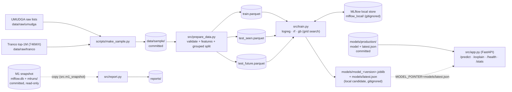
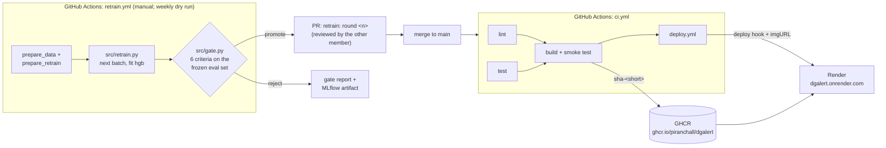

# DGAlert

**Flags malware-generated domain names (DGA) from the domain string alone, served as a FastAPI service.**

DGAlert classifies a domain such as `moiqidfvjjhjmndqp.in` as `benign` or `dga` (made by a malware
Domain Generation Algorithm) from 15 lexical features of its second-level label, and explains each
decision with SHAP. MLOps course project (BS CS, IBA, Fall 2026):

- **Milestone 1** (`v1.0-milestone1`): the model and the API.
- **Milestone 2:** Docker, CI, deployment to Render, `/stats` monitoring, and a retraining loop with
  a promotion gate (KaizenML) for new malware families.

Live service: **https://dgalert.onrender.com** (docs at `/docs`).

## Contents

1. [Project Focus](#project-focus)
2. [Architecture](#architecture)
3. [Quick start](#quick-start)
4. [Data](#data)
5. [Results](#results)
6. [Explainability and the drift story](#explainability-and-the-drift-story)
7. [API](#api)
8. [Docker](#docker)
9. [Deployment](#deployment)
10. [Limitations](#limitations)
11. [Tests](#tests)
12. [Citations](#citations)

## Project Focus

**KaizenML: automated retraining against drift.** New DGA families keep appearing, so the model is
retrained in rounds, and a retrained model replaces production only if a promotion gate accepts it.
The second focus is **explainability**: SHAP in `/explain` is how the main drift was found (matsnu).

**Why it fits.** 14 of the 46 usable UMUDGA families are held out as "future" malware (no live DGA
feed is freely available). The production model misses several: `matsnu` recall 0.0494, `nymaim`
0.2107, `simda` 0.4315, against 0.8853 on its training families.

**What is built:** a frozen evaluation set with a committed hash
([Retraining data](#retraining-data-milestone-2)); a six-criterion promotion gate comparing the
production model (champion) and the retrained one (challenger) on the same rows
([Promotion gate](#promotion-gate-milestone-2)); a retraining loop in GitHub Actions that opens a
reviewed PR on promotion ([Retraining loop](#retraining-loop-milestone-2)); and a feature-set
ablation and threshold-free metrics ([Results](#results)).

**Round 1 (matsnu) ran on `main` (Actions run 45668715690). The gate rejected it:**

| Measure (frozen eval set) | Champion (gb, M1) | Challenger (hgb + matsnu) | Gate result |
|---|---|---|---|
| matsnu recall | 0.0560 | 0.8727 | pass |
| seen F1 | 0.8891 | 0.8850 | pass |
| false-positive rate | 0.1066 | 0.1235 | **fail** (+0.0169; at most +0.005 allowed) |
| sanity domains | 6/6 | 6/6 | pass |

The report is committed unchanged as
[`reports/retrain/round_1_rejected.json`](reports/retrain/round_1_rejected.json) and
[`round_1_rejected.md`](reports/retrain/round_1_rejected.md). A separate analysis, retraining
without the matsnu rows, explains the rise:

- **The model change** (gb to HistGradientBoosting) adds +0.0031; **the matsnu rows** add +0.0138
  (396 benign domains newly flagged).
- **57.8% of those contain a hyphen,** against 9.4% of all benign domains (`anime-planet.com`,
  `tiger-explorer.com`, `national-lottery.biz`). matsnu joins English words with a hyphen
  (`accident-club.com`), and no earlier training DGA label had one, so real hyphenated sites now
  look like DGA.
- **The proposal's original rule** (strict F1 improvement plus sanity tests) would have promoted it:
  frozen-set F1 rose from 0.8870 to 0.8952.

**Demo:** Actions → "Retrain" → Run workflow on `main` (*dry_run* unticked); the run summary shows
the gate report. A promotion opens the PR "retrain: round <n> (automated)", whose merge deploys the
new model.

**Next steps (final presentation):** hyphen-insensitive features (hyphens removed, `hyphen_count`
dropped), a threshold chosen on validation for a target false-positive rate, and drift signals in
`/stats`.

## Architecture



Milestone 2 adds the delivery pipeline and the retraining loop:



- **Features** (`src/features.py`, shared by training, the API and the explainer) use only the
  second-level label (`mail.google.co.uk` → `google`, via `tldextract`). N-gram and dictionary
  features come from a fixed word list in `data/reference/`, never from training data.
- **The served model** is `models/production/`; `latest.json` records its SHA-256, which the loader
  checks (a mismatch gives 503).
- **The M1 MLflow store** (`mlflow.db`, `mlruns/`) is committed and read-only; new runs go to the
  gitignored `mlflow_local/`.

## Quick start

Every command shown in the Milestone 2 video, in order. Needs git and Docker; steps 4 and 7 also
need the GitHub CLI (`gh`).

### 1. Clean start

```powershell
git clone https://github.com/Piranchall/DGAlert.git
cd DGAlert
docker build --build-arg GIT_SHA=$(git rev-parse --short HEAD) -t dgalert:local .
docker run --rm -d -p 8000:8000 --name dgalert dgalert:local
do { Start-Sleep 2; $s = docker inspect -f '{{.State.Health.Status}}' dgalert; $s } while ($s -eq 'starting')
Start-Process http://127.0.0.1:8000/docs
curl.exe http://127.0.0.1:8000/health
curl.exe -X POST http://127.0.0.1:8000/predict -H "Content-Type: application/json" -d '{\"domain\": \"moiqidfvjjhjmndqp.in\"}'
```

```bash
git clone https://github.com/Piranchall/DGAlert.git
cd DGAlert
docker build --build-arg GIT_SHA=$(git rev-parse --short HEAD) -t dgalert:local .
docker run --rm -d -p 8000:8000 --name dgalert dgalert:local
while s=$(docker inspect -f '{{.State.Health.Status}}' dgalert); echo "$s"; [ "$s" = starting ]; do sleep 2; done
open http://127.0.0.1:8000/docs      # Linux: xdg-open http://127.0.0.1:8000/docs
curl http://127.0.0.1:8000/health
curl -X POST http://127.0.0.1:8000/predict -H "Content-Type: application/json" -d '{"domain": "moiqidfvjjhjmndqp.in"}'
```

`/health` shows `"status": "healthy"` with the built commit as `git_sha`; `/predict` returns
`"label": "dga"`. PowerShell 5.1 needs `curl.exe` (plain `curl` is `Invoke-WebRequest`) and escaped
JSON quotes; PowerShell 7.3+ takes the bash form of the body.

### 2. Docker health

```powershell
docker ps --filter name=dgalert
```

```bash
docker ps --filter name=dgalert
```

STATUS shows `(healthy)`.

### 3. Monitoring

```powershell
1..3 | % { curl.exe -s -X POST http://127.0.0.1:8000/predict -H "Content-Type: application/json" -d '{\"domain\": \"moiqidfvjjhjmndqp.in\"}' }
curl.exe -s -X POST http://127.0.0.1:8000/predict -H "Content-Type: application/json" -d '{\"domain\": \"google.com\"}'
curl.exe -s http://127.0.0.1:8000/stats
```

```bash
for i in 1 2 3; do curl -s -X POST http://127.0.0.1:8000/predict -H "Content-Type: application/json" -d '{"domain": "moiqidfvjjhjmndqp.in"}'; echo; done
curl -s -X POST http://127.0.0.1:8000/predict -H "Content-Type: application/json" -d '{"domain": "google.com"}'; echo
curl -s http://127.0.0.1:8000/stats; echo
```

Read in `/stats` (the counts include step 1's `/predict` call):

- `requests.by_endpoint["POST /predict"]`: `count` 5 and `avg_latency_ms`.
- `predictions.by_label`: `dga` 4, `benign` 1; `predictions.count` 5.
- `requests.total` also counts the Docker health checks (see [`GET /stats`](#get-stats)).

### 4. CI

Runs: the repository's **Actions** tab (https://github.com/Piranchall/DGAlert/actions), workflow
"CI".

The failing-test demo **needs push access to this repository**: anyone else runs it in their own
fork with Actions enabled. The pull request is a draft, is closed with its branch deleted, and is
**never merged**.

```powershell
git switch main; git pull --ff-only
git switch -c demo/failing-test
py -3 -c "open('tests/test_demo_failure.py', 'w', newline='\n').write('def test_deliberately_fails() -> None:\n    assert 1 + 1 == 3  # deliberate failure for the CI demo\n')"
git add tests/test_demo_failure.py
git commit -m "test: deliberately failing test for the CI demo (do not merge)"
git push -u origin demo/failing-test
$pr = gh pr create --draft --base main --title "DEMO: failing test (do not merge)" --body "Shows CI turning red on a failing test. Closed without merging."
gh pr checks $pr --watch      # lint passes, test fails, build is skipped
git switch main
gh pr close $pr --delete-branch --comment "Demo only: closed without merging."
```

```bash
git switch main; git pull --ff-only
git switch -c demo/failing-test
python3 -c "open('tests/test_demo_failure.py', 'w', newline='\n').write('def test_deliberately_fails() -> None:\n    assert 1 + 1 == 3  # deliberate failure for the CI demo\n')"
git add tests/test_demo_failure.py
git commit -m "test: deliberately failing test for the CI demo (do not merge)"
git push -u origin demo/failing-test
pr=$(gh pr create --draft --base main --title "DEMO: failing test (do not merge)" --body "Shows CI turning red on a failing test. Closed without merging.")
gh pr checks "$pr" --watch      # lint passes, test fails, build is skipped
git switch main
gh pr close "$pr" --delete-branch --comment "Demo only: closed without merging."
```

### 5. Deployment

```powershell
curl.exe https://dgalert.onrender.com/health
curl.exe -X POST https://dgalert.onrender.com/predict -H "Content-Type: application/json" -d '{\"domain\": \"moiqidfvjjhjmndqp.in\"}'
curl.exe -X POST https://dgalert.onrender.com/explain -H "Content-Type: application/json" -d '{\"domain\": \"wedding-muscle.com\"}'
curl.exe https://dgalert.onrender.com/stats
git rev-parse --short=7 origin/main
```

```bash
curl https://dgalert.onrender.com/health
curl -X POST https://dgalert.onrender.com/predict -H "Content-Type: application/json" -d '{"domain": "moiqidfvjjhjmndqp.in"}'
curl -X POST https://dgalert.onrender.com/explain -H "Content-Type: application/json" -d '{"domain": "wedding-muscle.com"}'
curl https://dgalert.onrender.com/stats
git rev-parse --short=7 origin/main
```

- **`git_sha` in `/health`** equals the `git rev-parse` output.
- **Right after a merge** it can be one commit behind `origin/main` for a few minutes, until the
  deploy job finishes.
- **The first call** after the service has been idle can take up to about a minute.

### 6. Rollback

See [RUNBOOK.md](RUNBOOK.md): rollback and roll-forward with
`gh workflow run deploy.yml -f tag=sha-<short sha>`.

### 7. Retraining

- **Gate summary of round 1** (rejected): the summary of run
  https://github.com/Piranchall/DGAlert/actions/runs/45668715690.
- **A dry run** (needs write access; `models/production/` is not changed):

```powershell
gh workflow run retrain.yml -f dry_run=true
```

```bash
gh workflow run retrain.yml -f dry_run=true
```

### 8. Cleanup

```powershell
docker rm -f dgalert
```

```bash
docker rm -f dgalert
```

## Data

### Sources

- **DGA:** UMUDGA ([Citations](#citations)), `<family>/list/10000.txt` per family.
- **Benign:** Tranco top-1M list [`746WX`](https://tranco-list.eu/list/746WX/1000000) (a 30-day
  average of several rankings, hard to manipulate).

`scripts/make_sample.py` builds the committed `data/sample/` from the raw files in `data/raw/`
(gitignored). `data/sample/SAMPLE_INFO.md` records every parameter, the Tranco SHA-256 and all drop
counts.

### Sample

| | Rows |
|---|---|
| Domains per UMUDGA family | up to 3000 (seed 42) |
| DGA rows, training families | 96000 |
| DGA rows, held-out families | 42000 |
| DGA rows, total | 138000 |
| Benign rows (Tranco) | 96000 |

- **Benign rows come evenly from Tranco's ten 100k-rank bands** (9600 per band), not the top N,
  because a resolver sees the whole long tail. Train is about 50/50.
- **Cleaning dropped** 6 `_wildcard_` rows, 1447 punycode (`xn--`) domains, 11 bare public suffixes
  and 10 domains found in both Tranco and a DGA list.

### Excluded and held-out families

- **Excluded:** `corebot`, `symmi`, `kraken_v1`, `kraken_v2` (the generated string sits in a
  dynamic-DNS subdomain the features never see) and `legit` (UMUDGA's benign list, overlapping
  Tranco).
- **Held out (simulated future malware):** `matsnu`, `nymaim`, `banjori`, `sisron`, `simda`, `dyre`,
  `padcrypt`, `shiotob`, `necurs`, `qakbot`, `tinba`, `murofet_v1`, `murofet_v2`, `murofet_v3`.
  These are 14 of the 46 usable families (about 30%): word-based, pronounceable and
  random-character families, never in M1 training.

### Split

`src/prepare_data.py` splits training families + benign 80/20 with `GroupShuffleSplit` **grouped by
second-level label** (seed 42). `test_future` is the held-out DGA rows plus the benign rows of
`test_seen` (3 held-out rows whose label occurs in train are dropped).

| Split | Rows | Benign | DGA | Benign fraction |
|---|---|---|---|---|
| train | 153627 | 76856 | 76771 | 0.5003 |
| test_seen | 38373 | 19144 | 19229 | 0.4989 |
| test_future | 61141 | 19144 | 41997 | 0.3131 |

Labels shared between train and `test_seen`: **0**. Between train and `test_future`: **0**
(`data/processed/split_report.json`).

### Retraining data (Milestone 2)

`src/prepare_retrain.py` (run after `prepare_data`) derives the retraining data from the three
splits, without changing them:

| Part | Rows | What it is |
|---|---|---|
| `train_fit` | 138248 | train minus validation: what retraining fits on (plus phased-in rows) |
| `validation` | 15379 | about 10% of train, for choosing hyperparameters |
| `phase_in_pool` | 33570 | about 80% of each held-out family, added one batch per round |
| `eval_frozen` | 46800 | `test_seen` (38373) + about 20% of each held-out family (8427): every candidate is scored on it |

- **Selection by label hash:** a label goes to the frozen slice (validation) when
  `sha256("<salt>:<label>")`, read as a fraction, is below 0.2 (0.1); salts `frozen-eval` and
  `validation`. Actual shares: 19.0% to 21.0% per held-out family, 9.1% to 11.4% per training family.
- **No leakage:** no label is shared between parts; the script stops if one is.
- **Frozen hash:** `reports/eval_frozen.json` commits the set's SHA-256 (`78f48f6b…`) and rows per
  family. The gate refuses any other set.
- **Phase-in batches** (`config.PHASE_IN_BATCHES`), worst M1 gb recall first:

| Batch | Families | M1 gb recall | Pool rows | Frozen eval rows |
|---|---|---|---|---|
| 1 | matsnu | 0.049 | 2409 | 589 |
| 2 | nymaim, simda | 0.211, 0.432 | 2391, 2430 | 609, 569 |
| 3 | dyre, shiotob | 0.646, 0.740 | 2381, 2370 | 619, 630 |
| never (control) | banjori, sisron, padcrypt, necurs, qakbot, tinba, murofet_v1, murofet_v2, murofet_v3 | 0.98 to 1.00 | 21589 | 5411 |

The control families are already caught, and keeping them unseen still measures families never
trained on.

### Promotion gate (Milestone 2)

`src/gate.py` scores the champion and the challenger on the same frozen rows; it never compares
stored numbers. The challenger is promoted only if all six criteria hold (thresholds in
`src/config.py`, boundaries inclusive):

| # | Criterion | Measured on | Rule |
|---|---|---|---|
| 1 | frozen eval hash | the whole frozen eval set | equals `sha256` in `reports/eval_frozen.json` |
| 2 | new-family recall | DGA rows of the families added this round, pooled | rises by at least 0.02 |
| 3 | seen F1 | the `test_seen` rows (training families + benign) | drops by at most 0.01 |
| 4 | false-positive rate | benign rows flagged as dga | rises by at most 0.005 |
| 5 | earlier-family recall | DGA rows of families phased in during earlier rounds, pooled | drops by at most 0.02; passes when there are none (round 1) |
| 6 | sanity domains | `config.SANITY_DOMAINS` (the same list as the sanity tests) | all classified correctly |

- **Criterion 5 was added beyond the plan's five:** earlier families are not among the seen-F1
  rows, so losing a ~600-row family would otherwise barely show.
- **The decision JSON** lists every failed criterion with its values, delta and threshold, plus both
  models' metrics. ROC-AUC and PR-AUC are reported too, but **not gated**
  ([threshold-free metrics](#threshold-free-metrics)).

### Retraining loop (Milestone 2)

`src/retrain.py` runs one round:

1. **Plan:** take the next batch after the `phased_in_families` in `models/production/latest.json`.
2. **Train** a `HistGradientBoostingClassifier` (`hgb`) on `train_fit` plus the phased-in pool rows.
   The parameters are fixed in `config.HGB_PARAMS` (deterministic, about 10 s per fit). They were
   chosen once by `scripts/select_hgb_params.py` (16 grid points, F1 on `validation`): the cheapest
   point within 0.001 of the best F1 (0.8902) was learning rate 0.1, 200 iterations, 63 leaves,
   F1 0.8894.
3. **Gate** against the production model, **log** to MLflow (`dgalert-m2-kaizen`), and write
   `reports/retrain/round_<n>.json` / `.md`.
4. **On promotion** (not `--dry-run`): replace the model in `models/production/`, update
   `latest.json` (`round`, `phased_in_families`, frozen hash) and `reports/production_model.json`.
   [RUNBOOK.md](RUNBOOK.md#roll-back-a-model) covers model rollback.

```powershell
venv\Scripts\python -m src.prepare_data
venv\Scripts\python -m src.prepare_retrain
venv\Scripts\python -m src.retrain --dry-run   # train and gate only; models/production/ unchanged
```

**In GitHub Actions** (`.github/workflows/retrain.yml`):
- **Real rounds are manual** (on `main`, *dry_run* unticked). A promotion opens the PR
  **"retrain: round <n> (automated)"** with `RETRAIN_PR_TOKEN` (the default `GITHUB_TOKEN` would not
  trigger CI), and review goes to the other member.
- **The weekly run** (Mondays 03:00 UTC) is always a dry run.
- **Every run** uploads the MLflow store and round report as an artifact (90 days), and does nothing
  while its round's PR is open.

**A rejected batch is retried unchanged:** with deterministic data and training, the same features
and parameters give the same decision. Round 1 was rejected in the real run and in a local dry run.
Once a retrained model is live, `python -m src.report` needs `DGALERT_MLFLOW_TRACKING_URI` set to
the artifact's `mlflow.db`.

## Results

Three MLflow parent runs in experiment `dgalert-m1` (seed 42, threshold 0.5 on P(dga), positive
class dga), from `reports/m1_results.json`:

| Model | Features | f1_seen | precision_seen | recall_seen | f1_future | recall_future | train_time_s |
|---|---|---|---|---|---|---|---|
| logreg | 8 basic (no dictionary / n-gram) | 0.7635 | 0.7721 | 0.7552 | 0.8414 | 0.8003 | 0.6825 |
| rf | all 15 | 0.884 | 0.8828 | 0.8852 | 0.8549 | 0.7867 | 10.487 |
| **gb** | all 15 | **0.8891** | **0.8929** | **0.8853** | **0.8584** | **0.7885** | 261.2648 |

- **logreg:** `StandardScaler` + `LogisticRegression` (C=1.0, `class_weight="balanced"`).
- **rf:** `RandomForestClassifier`, 100 trees, `class_weight="balanced"`.
- **gb:** `GradientBoostingClassifier`, grid-searched (27 points, 3-fold `GroupKFold` by label, on
  a stratified 40000-row subsample; each point is a nested MLflow run).
  - Best point: `n_estimators=200`, `max_depth=7`, `learning_rate=0.05`, CV F1 0.8841 ± 0.0026.
  - It was then refit on all of train.

**Compare recall, not F1, across test sets.** `test_seen` is 0.5011 DGA (19229 of 38373 rows) and
`test_future` 0.6869 (41997 of 61141). More positives inflate precision and F1, which is why
logreg's `f1_future` beats its `f1_seen`. Recall shows the drift: gb catches 0.8853 of seen-family
DGA domains and 0.7885 of unseen ones.

### Why gb

gb is deployed because it is **best on `f1_seen`, the metric declared in advance** (0.8891 against
0.884 for rf), its artifact is much smaller than the random forest's, and SHAP is much faster on it.
Caveats:
- **The lead over rf is small** (0.0051 F1 seen, 0.0035 unseen); rf is better on `suppobox_2`,
  `vawtrak_v3` and `rovnix`.
- **The best `max_depth` (7) and `learning_rate` (0.05) sit at the grid's edges.**
- **`train_time_s` (261.2648) is the refit only;** the grid search took 357 s of the 622 s run (of
  ~11 minutes of training).

### Feature-set ablation (Milestone 2)

M1 gave logreg the 8 basic features and the trees all 15, which mixes model and features.
`python -m scripts.ablation` (`make ablation`) fits the full 2 x 2 grid on the M1 splits with M1's
parameters. The MLflow experiment is `dgalert-m2-ablation`, and the results are in
`reports/ablation.json`.

| Model | Features | f1_seen | recall_future | dyre recall | matsnu recall |
|---|---|---|---|---|---|
| logreg | 8 basic (M1) | 0.7635 | 0.8003 | 1.0 | 0.0587 |
| logreg | all 15 | 0.8291 | 0.8194 | 1.0 | 0.0123 |
| gb | 8 basic | 0.7861 | 0.6771 | 0.2753 | 0.0207 |
| gb | all 15 (M1, production) | 0.8891 | 0.7885 | 0.646 | 0.0494 |

- **The two M1 cells reproduce M1 exactly;** a rerun is byte-identical.
- **The 0.1256 `f1_seen` gap is about half features, half model:** the extra features lift logreg by
  0.0656 (0.7635 → 0.8291), and with the same 15 features gb still leads by 0.06.
- **On 15 features logreg has the higher unseen recall** (0.8194 against 0.7885) but lower seen
  precision (0.8385 against 0.8929). The features help gb more (+0.103 against +0.0656).
- **gb stays in production:** it is best on `f1_seen` even against logreg on the same features.

### Threshold-free metrics

The Milestone 1 review said:

> "Concept drift findings were well established. Predictions on unseen data were based on seen
> families. Recommendation: use ROC-AUC, especially for evaluating on unseen data."

**Recall at 0.5, a threshold fitted on the training families, mixes two effects on an unseen
family:** it is either ranked as benign (no threshold helps) or ranked correctly but below 0.5
(another threshold would catch it). **ROC-AUC separates the two:** 1.0 is a perfect ranking, 0.5
random, below 0.5 the wrong way round, independent of class balance. PR-AUC (average precision)
sits next to it, with the DGA share as baseline (0.5011 seen, 0.6869 unseen).

| Model | ROC-AUC seen | ROC-AUC unseen | PR-AUC seen | PR-AUC unseen |
|---|---|---|---|---|
| logreg (8 basic features) | 0.8648 | 0.8363 | 0.8758 | 0.9373 |
| rf | 0.9582 | 0.8779 | 0.9574 | 0.9459 |
| **gb** | **0.9634** | **0.8721** | **0.9645** | **0.9512** |

The drift shows without a threshold (gb 0.9634 → 0.8721), and on unseen families rf ranks slightly
better (0.8779).

**Per held-out family (gb):** the family's DGA rows against all 19,144 benign rows of `test_future`
(13.5% positives, so a random PR-AUC is about 0.135).

| Family | ROC-AUC | PR-AUC | Recall at 0.5 |
|---|---|---|---|
| matsnu | **0.1868** | 0.0810 | 0.0494 |
| nymaim | **0.5185** | 0.1624 | 0.2107 |
| simda | 0.7369 | 0.3820 | 0.4315 |
| dyre | 0.8929 | 0.4754 | 0.6460 |
| shiotob | 0.9180 | 0.7973 | 0.7403 |
| banjori | 0.9825 | 0.7974 | 1.0 |
| the other 8 | 0.9914 to 0.9997 | 0.9537 to 0.9978 | 0.981 to 1.0 |

- **matsnu and nymaim are ranked as benign; no threshold fixes them.** matsnu (0.1868) scores *more*
  benign than real benign domains (logreg 0.1235, rf 0.2972), and nymaim (0.5185) is at chance.
  Both need data or features, so they are the first two phase-in batches.
- **dyre and shiotob are partly a threshold problem** (ROC-AUC about 0.9, recall 0.646 and 0.7403);
  simda (0.7369 / 0.4315) is in between. No family has a high ROC-AUC with a really low recall.
- **The other nine** are ranked almost perfectly (0.9825 or more).

`reports/m1_auc.json` (with the logreg and rf tables) is written by `python -m src.report --auc`
and **regenerated locally, not in CI**: it needs `data/processed/` and the M1 model files (gb from
`models/production/`, logreg and rf from the gitignored `models/`). Each model's recomputed metrics
must first equal `m1_results.json`, and its SHA-256 is recorded.

**In the gate,** ROC-AUC and PR-AUC are reported, not gated. Round 1, recomputed with a dry run (its
six criteria match the unchanged `round_1_rejected.json`):

| Rows (frozen eval set) | Champion ROC-AUC | Challenger ROC-AUC | Champion PR-AUC | Challenger PR-AUC |
|---|---|---|---|---|
| all rows | 0.9360 | 0.9534 | 0.9623 | 0.9692 |
| matsnu against benign | 0.1876 | 0.9298 | 0.0174 | 0.2060 |

Retraining fixes matsnu's ranking (0.1876 → 0.9298), but its PR-AUC stays low: 0.2060 against a
baseline of 0.0298 (589 matsnu rows among 19,144 benign). Many top-scored domains are benign, the
same false-positive problem the gate rejected.

### Per-family recall (gb)

All three models: `reports/per_family_recall.json` (for `benign`, the share predicted benign).

- **`test_seen`:**
  - **Perfect:** `fobber_v1`, `qadars`, `ramdo`, `ranbyus_v1`, `ranbyus_v2`, `zeus-newgoz`.
  - **Weakest:** `suppobox_2` 0.2228, `vawtrak_v3` 0.6054, `pizd` 0.6931, `suppobox_1` 0.697.
  - **Benign:** 0.8934.
  - **logreg, without the dictionary and n-gram features,** scores 0.0 on `pushdo`, `vawtrak_v2` and
    `vawtrak_v3` (gb 0.913, 0.8125, 0.6054).
- **`test_future`:**
  - **Caught:** `banjori`, `murofet_v1`, `murofet_v3` 1.0; `murofet_v2` and `sisron` 0.9987;
    `padcrypt` 0.998; `tinba` 0.9927; `qakbot` 0.9917; `necurs` 0.981.
  - **Missed:** see the AUC table above.

## Explainability and the drift story

`POST /explain` returns the prediction and the features that pushed it toward `dga` (positive) or
`benign` (negative). For gb these are SHAP values in log-odds, and `base_value` plus all 15
contributions equals the model's log-odds (checked in the tests).

### matsnu: "hyphen + English words = benign"

The response for `wedding-muscle.com`, a held-out matsnu domain:

```json
{
  "domain": "wedding-muscle.com",
  "label": "benign",
  "probability": 0.0036,
  "model_version": "20261105_062411",
  "in_scope": true,
  "warning": null,
  "output_units": "log_odds",
  "base_value": -0.03691765562588492,
  "top_contributing_features": [
    {"feature": "hyphen_count", "value": 1.0, "contribution": -3.42574984061764},
    {"feature": "bigram_unseen_ratio", "value": 0.15384615384615385, "contribution": -1.021768467627285},
    {"feature": "trigram_mean_logfreq", "value": -3.9781896608308833, "contribution": -0.5972774506335715},
    {"feature": "bigram_mean_logfreq", "value": -2.837270528388683, "contribution": -0.39355988586259727},
    {"feature": "dict_coverage", "value": 1.0, "contribution": -0.30221298405663727}
  ]
}
```

- **`hyphen_count` dominates** (−3.43 log-odds, about three times the next feature).
- **No training DGA label contains a hyphen,** while many benign ones do, so the model learned
  "hyphen + English words = benign". All three models catch only about 5% of matsnu (gb 0.0494,
  rf 0.0457, logreg 0.0587).
- **Retraining on matsnu swaps one shortcut for another:** recall rose from 0.056 to 0.873, but
  hyphenated benign sites were flagged too and the gate rejected it. Hyphen-insensitive features
  are the planned fix.

### dyre and the tree models

dyre labels are one letter plus 33 hex characters (`a022b679b3dcd50dda1b4c6633662a3512`), always
34 characters long. The tree models miss about a third of them (gb 0.646, rf 0.641), while logreg
catches all of them (1.0).

**Correction of the M1 claim "trees cannot extrapolate":**
- **dyre is mostly inside the trained range:** 17 training labels are 34+ characters (up to 54),
  all benign. Only `digit_letter_transitions` exceeds it (5 to 27, against at most 20).
- **Length is not the cause.** Mean SHAP over gb's 1,062 dyre misses: `digit_ratio` −1.66,
  `unique_char_ratio` −1.23, `length` only −0.23. 16 hex symbols give a low unique-character ratio,
  which in long training labels was mostly benign.
- **It depends on the model:** gb on the 8 basic features catches 0.2753 (all 15: 0.646), while the
  M1 review expected about 0.89 from default HistGradientBoosting. logreg's weighted sum is pushed
  steadily toward dga.

dyre is in the third phase-in batch.

## API

| Method | Path | Purpose |
|---|---|---|
| `POST` | `/predict` | Classify one domain: `label` (`benign` or `dga`) and P(dga) |
| `POST` | `/explain` | The same prediction plus the top 5 SHAP feature contributions |
| `GET` | `/health` | Model and explainer status: 200 `healthy` or `degraded`, 503 `unhealthy` (used by health checks) |
| `GET` | `/stats` | Request counts, latency and prediction statistics since the service started |
| `GET` | `/docs` | Interactive OpenAPI docs with request and response examples |
| `GET` | `/` | Redirects (307) to `/docs` |

The model and explainer load once at startup from `models/production/latest.json` (`MODEL_POINTER`
overrides it). If loading fails, including the SHA-256 check, the service still starts: `/health`
reports it, and `/predict` and `/explain` return 503.

**Input:** at most 1,024 characters (checked first), then trimmed and lowercased with scheme, path,
port and trailing dot removed (`HTTP://Example.COM/path` → `example.com`). It must be a valid DNS
name (ASCII, at least one dot, labels of 1-63 letters/digits/hyphens without leading or trailing
hyphen, at most 253 characters, not a bare suffix like `co.uk`) ending in a known public suffix, so
IPs (`8.8.8.8`) and internal names (`host.local`) are rejected. Anything else gets a 422.

### Scope warnings

Valid domains the model cannot judge still get a prediction, with `"in_scope": false` and a
`warning` (counted in `/stats` as `predictions.out_of_scope`):

- **Private suffixes** (C1), e.g. `x.blogspot.com`, `x.duckdns.org`, `x.github.io`: the features see
  only the provider's label (`blogspot`). `blogspot.com` itself is in scope.
- **Punycode** (C2): any `xn--` label (`xn--bcher-kva.de`, `example.xn--p1ai`), which the ASCII
  training data does not cover.

```json
{"domain": "abcxyzqwrtplk.blogspot.com", "label": "benign", "probability": 0.0451, "model_version": "20261105_062411", "in_scope": false, "warning": "'abcxyzqwrtplk.blogspot.com' is under the private suffix 'blogspot.com' (a hosting or dynamic-DNS provider); the model only sees the label 'blogspot', so the prediction says nothing about 'abcxyzqwrtplk'."}
```

### `POST /predict`

```bash
curl -X POST http://127.0.0.1:8000/predict -H "Content-Type: application/json" -d '{"domain": "moiqidfvjjhjmndqp.in"}'
```

```json
{"domain": "moiqidfvjjhjmndqp.in", "label": "dga", "probability": 0.996, "model_version": "20261105_062411", "in_scope": true, "warning": null}
```

```json
{"domain": "teco.com.tw", "label": "benign", "probability": 0.0021, "model_version": "20261105_062411", "in_scope": true, "warning": null}
```

Both domains are from `test_seen` (`ranbyus_v2` and Tranco), never trained on. `probability` is
P(dga) to 4 decimals; `label` is `dga` at 0.5 or above.

Invalid input, HTTP 422. For `-bad.com`:

```json
{"detail": [{"type": "value_error", "loc": ["body", "domain"], "msg": "Value error, label '-bad' must not start or end with a hyphen", "input": "-bad.com", "ctx": {"error": {}}}]}
```

For `8.8.8.8`:

```json
{"detail": [{"type": "value_error", "loc": ["body", "domain"], "msg": "Value error, '8.8.8.8' has no known public suffix; IP addresses and internal names are not supported", "input": "8.8.8.8", "ctx": {"error": {}}}]}
```

### `POST /explain`

Same request and validation as `/predict`. The response adds `base_value`, the 5 largest
contributions, and `output_units`: `log_odds` for gb, hgb and logreg, `probability` for rf. See the
`wedding-muscle.com` example above.

```bash
curl -X POST http://127.0.0.1:8000/explain -H "Content-Type: application/json" -d '{"domain": "wedding-muscle.com"}'
```

### `GET /health`

```json
{"status": "healthy", "model_loaded": true, "explainer_loaded": true, "git_sha": "67fc13b", "model_version": "20261105_062411"}
```

`git_sha` is the commit the image was built from (build arg `GIT_SHA`), or `"unknown"` when it was
not set.

| `status` | HTTP | When |
|---|---|---|
| `healthy` | 200 | model and explainer loaded |
| `degraded` | 200 | model loaded but the explainer failed: `/predict` works, `/explain` returns 503 |
| `unhealthy` | 503 | no model (`{"status": "unhealthy", "model_loaded": false, "explainer_loaded": false, "git_sha": "..."}`) |

`degraded` stays 200, so the health checks do not restart a service that still answers `/predict`.

### `GET /stats`

Monitoring counters since the service started. It always returns 200; `model_version` is `null`
when there is no model.

```json
{
  "model_version": "20261105_062411",
  "started_at": "2026-11-25T09:00:00.000+00:00",
  "uptime_seconds": 123.456,
  "requests": {
    "total": 6,
    "by_status_class": {"2xx": 5, "4xx": 1},
    "avg_latency_ms": 7.512,
    "by_endpoint": {
      "GET /health": {"count": 2, "by_status_class": {"2xx": 2}, "avg_latency_ms": 0.811},
      "POST /predict": {"count": 4, "by_status_class": {"2xx": 3, "4xx": 1}, "avg_latency_ms": 10.863}
    }
  },
  "predictions": {"count": 3, "by_label": {"benign": 2, "dga": 1}, "mean_probability_dga": 0.3349, "out_of_scope": 1}
}
```

- **`requests`:** every request per status class and per endpoint; unknown paths (`/wp-admin`)
  go under `unmatched`.
- **`predictions`:** successful `POST /predict` calls only (count per label, mean P(dga), out of
  scope).
- **In memory:** counters reset on every restart, including Render spin-downs (`started_at`).
  Health checks inflate `requests.total`.

Each request also logs one JSON line to stdout (`dgalert.access`), never the request body:

```json
{"timestamp": "2026-11-25T09:00:01.234+00:00", "method": "POST", "path": "/predict", "status": 200, "latency_ms": 9.81, "label": "dga", "probability": 0.996}
```

## Docker

[Quick start](#quick-start) builds and runs the image. `make docker-build` and `make docker-run`
do the same on Linux/macOS.

- **Image:** multi-stage build on `python:3.13.18-slim-trixie` (pinned patch release), with only
  `requirements-api.txt` (no mlflow, pytest or ruff), `src/`, `data/reference/` and
  `models/production/`. About 705 MB unpacked (161 MB compressed).
- **Non-root user** `dgalert` (uid 10001); `NUMBA_CACHE_DIR=/tmp/numba_cache` for shap.
- **Port** `0.0.0.0:${PORT:-8000}`, so Render's `PORT` works
  (`docker run --rm -e PORT=9000 -p 9000:9000 dgalert:local`).
- **Health check:** `/health` via Python's `urllib`, every 2 s while starting, then every 10 s;
  `healthy` and `degraded` pass.
- **Logs:** one JSON line per request (`docker logs dgalert`).

## Deployment

The API runs on Render (free instance) at **https://dgalert.onrender.com**. It runs the prebuilt
image `ghcr.io/piranchall/dgalert` from GHCR (no build on Render), with health-check path `/health`.
The live calls are in [Quick start, step 5](#5-deployment).

**Every merge to `main` deploys itself:**
1. CI's `build` smoke-tests the image and pushes it as `sha-<short sha>` and `main` ([CI](#ci)).
2. The `deploy` job (`.github/workflows/deploy.yml`) checks the image exists, then calls the deploy
   hook (secret `RENDER_DEPLOY_HOOK`) with `imgURL=ghcr.io/piranchall/dgalert:sha-<short sha>`, so
   Render runs exactly the tested image.
3. It polls `/health` every 10 seconds until `git_sha` is the merged commit (timeout about 10
   minutes).

- **Rollback / roll-forward:** the same workflow by hand, no Render login
  (`gh workflow run deploy.yml -f tag=sha-<short sha>`); see [RUNBOOK.md](RUNBOOK.md), which also
  covers model rollbacks and failing health checks.
- **Version tags (`v*`)** publish an image but do not deploy.
- **Cold starts:** a free instance sleeps after about 15 idle minutes; the next request can wait up
  to about a minute, and `/stats` restarts from zero.

## Limitations

- **Purely lexical features:** no DNS, WHOIS or traffic, so word-based DGAs look like real names.
  The training family `suppobox` is partly missed (`suppobox_1` 0.697, `suppobox_2` 0.2228,
  `suppobox_3` 0.9777); held-out word-based families do worse (`matsnu` 0.0494, `nymaim` 0.2107).
- **Out of scope:** dynamic-DNS families (`corebot`, `symmi`, `kraken_v1`, `kraken_v2`), and punycode,
  which was excluded from training (1447 `xn--` domains; accepted with a scope warning).
- **The benign set leans toward lower ranks:** 90% of benign rows come from below the top 100,000,
  where names look more random. This lowers precision but is closer to what a resolver sees.
- **One hyphen hides a DGA domain.** `scripts/hyphen_evasion.py` inserts one hyphen into 2000
  `test_seen` DGA domains (seed 42) that gb flags (`moiqidfvjjhjmndqp.in` → `moiqidfv-jjhjmndqp.in`):
  the share still flagged is **0.0000**, and the demo domain drops from P(dga) 0.996 to 0.0067
  (`hyphen_count` −7.50 log-odds). **0 of the 76771 training DGA rows** have a hyphen, and round 1
  showed retraining on matsnu alone does not fix it. Run it with `python -m scripts.hyphen_evasion`.
- **False alarms dominate when DGA is rare.** gb's false-positive rate is **0.1066** (1 − benign
  recall 0.8934). In 10,000 domains with 1% DGA, gb finds about 89 of the 100 (`recall_seen`
  0.8853) but flags about 1,055 of the 9,900 benign ones: only about 7.7% of alerts are real
  (88.53 / (88.53 + 1055.34) = 0.0774). A threshold tuned on validation is planned.
- **Tranco label noise:** Tranco ranks popularity, not safety, so its long tail includes
  machine-generated-looking names that may be malicious (e.g. `zpsczg.cn`, flagged in round 1). Part
  of the 0.1066 may be label noise; how much is not measured.

## Tests

From a Python 3.13 venv with `requirements.txt` installed:

```powershell
venv\Scripts\python -m pytest -q
venv\Scripts\ruff check src tests scripts
venv\Scripts\ruff format --check src tests scripts
```

The tests need no raw data or trained candidates (they train tiny models on `data/sample/`), read
the M1 snapshot only through temporary copies, and fail if the committed `mlflow.db` hash changes.
`@pytest.mark.sanity` tests check the committed production model (`teco.com.tw` benign,
`moiqidfvjjhjmndqp.in` dga); run them alone with `pytest -m sanity`.

### CI

GitHub Actions (`.github/workflows/ci.yml`, Ubuntu, Python 3.13) runs on every pull request, on
pushes to `main` and on `v*` tags. `lint`, `test` and `build` are the required checks:

| Job | What it does |
|---|---|
| `lint` | `ruff check` and `ruff format --check` with the pinned ruff |
| `test` | `pytest -q`, including the sanity tests on the production model |
| `build` | after `lint` and `test`: builds the image with `GIT_SHA`, waits until healthy, checks that `/health` shows the commit and `/predict` labels `moiqidfvjjhjmndqp.in` as `dga` |
| `deploy` | pushes to `main` only, after `build`: runs `deploy.yml` with the image's `sha-` tag ([Deployment](#deployment)) |

On pushes to `main` and `v*` tags, `build` pushes **the image it just tested** to GHCR as
`ghcr.io/piranchall/dgalert:sha-<short sha>`, plus `:main` or the version tag (e.g.
`:v2.0-milestone2`). Pull requests never push.

| File | Covers |
|---|---|
| `tests/test_config.py` | paths, local MLflow store and overrides, gitignored folders, seed, disjoint family lists |
| `tests/test_features.py` | normalization, label extraction, every feature, dictionary split |
| `tests/test_prepare_data.py` | validation drops, grouped split, held-out families only in `test_future`, identical reruns |
| `tests/test_prepare_retrain.py` | hash rule, no shared labels, shares per family, stable membership, M1 counts unchanged, frozen report and hash |
| `tests/test_train.py` | tiny training run, MLflow runs, `latest.json` promotion, reports, committed store refused |
| `tests/test_m1_snapshot.py` | snapshot hash unchanged, relocated copy, `reports/` rebuilt equal, production report matches the pointer |
| `tests/test_gate.py` | promote; reject on each criterion alone; boundaries; earlier-family criterion; AUCs reported but never gated; end to end |
| `tests/test_retrain.py` | batch planning; promotion, rejection and dry run on a small setup; a second round; MLflow run; Markdown report |
| `tests/test_retrain_workflow.py` | `retrain.yml`: dry-run defaults, `main` only, permissions, no duplicate PRs, token and reviewer |
| `tests/test_ablation.py` | the 2 x 2 grid, feature sets, M1 parameters, deterministic report, MLflow runs |
| `tests/test_metrics.py` | ROC-AUC / PR-AUC on hand-computed examples, per-family scoring, the M1 AUC report and its checks |
| `tests/test_readme_walkthrough.py` | Quick start: step order, both shells per step, one container name, `127.0.0.1`, `/stats` counts, CI demo as a closed draft, links and workflow inputs |
| `tests/test_model_loader.py` | pointer loading and override, SHA-256 check, version warning, the committed production model |
| `tests/test_app.py` | `/health` and `/predict`: success, 503 cases, every 422 rule |
| `tests/test_monitoring.py` | `/stats` counters, latency, label counts, `unmatched`, thread safety, JSON access log |
| `tests/test_hardening.py` | scope warnings (C1, C2), `degraded` health (C3), input limit (C4), `output_units` (C5), `/` redirect (C6) |
| `tests/test_ci.py` | CI jobs, triggers, pinned ruff, permissions, publishing rules, smoke test, deploy job |
| `tests/test_deploy_workflow.py` | `deploy.yml` triggers, tag format, image check, hook from the secret, wait and timeout; README and RUNBOOK |
| `tests/test_docker.py` | `GIT_SHA` in `/health`; `Dockerfile` and `.dockerignore` checks |
| `tests/test_explain.py` | `/explain` shape and agreement with `/predict`; SHAP additivity for gb, hgb, rf and logreg |
| `tests/test_hyphen_evasion.py` | hyphen insertion keeps the suffix and splits the label in the middle |

## Citations

- **UMUDGA**: M. Zago, M. Gil Pérez, G. Martínez Pérez. "UMUDGA: A dataset for profiling
  algorithmically generated domain names in botnet detection." *Data in Brief* 30 (2020), 105400.
  DOI [10.1016/j.dib.2020.105400](https://doi.org/10.1016/j.dib.2020.105400).
  Dataset: Mendeley Data, DOI [10.17632/y8ph45msv8.1](https://doi.org/10.17632/y8ph45msv8.1) (MIT
  licence). This is the reference used throughout the project, slides included.
- **Tranco**: V. Le Pochat, T. Van Goethem, S. Tajalizadehkhoob, M. Korczyński, W. Joosen.
  "Tranco: A Research-Oriented Top Sites Ranking Hardened Against Manipulation." *NDSS* 2019.
  List `746WX`: https://tranco-list.eu/list/746WX/1000000
- **SCOWL** (Spell Checker Oriented Word Lists), K. Atkinson, version 2020.12.07, size 50,
  American English: http://wordlist.aspell.net/. Licence in `data/reference/SCOWL-LICENSE.txt`.
- **tldextract**, J. Kurkowski: https://github.com/john-kurkowski/tldextract
- **SHAP**: S. M. Lundberg, S.-I. Lee. "A Unified Approach to Interpreting Model Predictions."
  *NeurIPS* 2017. S. M. Lundberg et al. "From local explanations to global understanding with
  explainable AI for trees." *Nature Machine Intelligence* 2 (2020).
- **scikit-learn**: F. Pedregosa et al. "Scikit-learn: Machine Learning in Python." *JMLR* 12
  (2011), 2825-2830.
- **MLflow**: M. Zaharia et al. "Accelerating the Machine Learning Lifecycle with MLflow."
  *IEEE Data Engineering Bulletin* 41(4), 2018.
- **FastAPI**, S. Ramírez: https://fastapi.tiangolo.com

## Licence

MIT, see [LICENSE](LICENSE). Team: Piranchal (29050) and Muhammad Hussain (28985).
