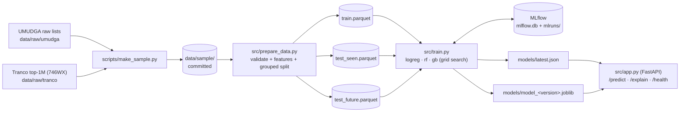

# DGAlert

**Flags malware-generated domain names (DGA) from the domain string alone, served as a FastAPI service.**

DGAlert classifies a domain such as `moiqidfvjjhjmndqp.in` as `benign` or `dga` (made by a malware
Domain Generation Algorithm) using 15 lexical features of its second-level label, and explains each
decision with SHAP. It is the Milestone 1 deliverable of an MLOps course project (BS CS, IBA,
Fall 2026). Milestone 2 adds automated retraining (KaizenML) as new malware families appear.

## Contents

1. [Architecture](#architecture)
2. [Quick start](#quick-start)
3. [Data](#data)
4. [Results](#results)
5. [Explainability and the drift story](#explainability-and-the-drift-story)
6. [API](#api)
7. [Limitations](#limitations)
8. [Tests](#tests)
9. [Citations](#citations)

## Architecture



All features are defined once in `src/features.py` and used by `prepare_data`, `train`, the API
and the explainer. Features use only the second-level label (`mail.google.co.uk` -> `google`,
via `tldextract` with its bundled public suffix list). The n-gram and dictionary features come from
a fixed English word list in `data/reference/`, never from the training data, to avoid leakage.

## Quick start

**Requires Python 3.13.**

`data/raw/` is not needed: `prepare_data` reads the committed sample in `data/sample/`.

Windows (PowerShell, from the repo root):

```powershell
py -3.13 -m venv venv
venv\Scripts\python -m pip install -r requirements.txt

venv\Scripts\python -m src.prepare_data          # writes data/processed/
venv\Scripts\python -m src.train --model all     # trains logreg, rf, gb; writes models/latest.json
venv\Scripts\python -m pytest -q

venv\Scripts\python -m uvicorn src.app:app       # API at http://127.0.0.1:8000, docs at /docs
venv\Scripts\mlflow ui --backend-store-uri sqlite:///mlflow.db   # run history at http://127.0.0.1:5000
```

Training takes about 11 minutes, almost all of it the gradient boosting grid search
(27 grid points x 3 folds).

Linux/macOS equivalents (see `Makefile`):

| Step | Command |
|---|---|
| venv + install | `make setup` |
| prepare data | `make data` |
| train (all models) | `make train` |
| tests | `make test` |
| ruff lint + format check | `make lint` |
| serve the API (with `--reload`) | `make serve` |

Training adds runs to the committed MLflow store (`mlflow.db`, `mlruns/`) and rebuilds `reports/`.
`models/latest.json` is only replaced when the new best model has a strictly higher `f1_seen` than
the current one (`python -m src.train --force` overrides this).

## Data

### Sources

- **DGA domains: UMUDGA** (Zago, Gil Pérez and Martínez Pérez, 2020), Mendeley Data,
  DOI [10.17632/y8ph45msv8.1](https://doi.org/10.17632/y8ph45msv8.1), MIT licence.
  For each family only `<family>/list/10000.txt` is used; the family name is the folder name.
- **Benign domains: Tranco** top-1M list
  [`746WX`](https://tranco-list.eu/list/746WX/1000000). Tranco averages several popularity
  rankings over 30 days, so it is much harder to manipulate than a single ranking.

The raw files are downloaded manually into `data/raw/` (gitignored). `scripts/make_sample.py`
builds the committed sample in `data/sample/`; `data/sample/SAMPLE_INFO.md` records every
parameter, the Tranco file's SHA-256 and all drop counts.

### Sample

| | Rows |
|---|---|
| Domains per UMUDGA family | up to 3000 (seed 42) |
| DGA rows, training families | 96000 |
| DGA rows, held-out families | 42000 |
| DGA rows, total | 138000 |
| Benign rows (Tranco) | 96000 |

Benign rows are sampled **evenly across the ten 100k-rank bands** of Tranco (9600 per band), not
taken from the top N. The top of the list is dominated by short, famous brand names, which are
easy to tell apart from random strings. A DNS resolver sees the whole long tail, so the benign set
should too; otherwise the model learns "short and famous = benign" and the test scores are
optimistic.

The benign count equals the number of training-family DGA rows (96000), so train is about 50/50
benign vs DGA. The per-family cap of 3000 keeps any single family from dominating.

Cleaning dropped 6 Tranco `_wildcard_` rows, 1447 punycode (`xn--`) domains, 11 bare public
suffixes, and 10 domains that appeared both in Tranco and in a DGA list (dropped from both sides).

### Excluded families (never used)

`corebot`, `symmi`, `kraken_v1`, `kraken_v2`, `legit`.

- `corebot`, `symmi`, `kraken_v1`, `kraken_v2` put the generated string in a dynamic-DNS
  subdomain (e.g. `x.ddns.net`), so their second-level label is just the provider's name. A
  second-level-label classifier cannot see them.
- `legit` is UMUDGA's own benign list. It overlaps Tranco heavily, and Tranco is our benign source.

### Held-out families (simulated future malware)

`matsnu`, `nymaim`, `banjori`, `sisron`, `simda`, `dyre`, `padcrypt`, `shiotob`, `necurs`,
`qakbot`, `tinba`, `murofet_v1`, `murofet_v2`, `murofet_v3`.

These 14 of the 46 usable families (about 30%, chosen by the team) never appear in training.
Their rows go only to `test_future`, which simulates malware that appears after the model was
trained. `f1_future` and per-family recall on `test_future` are the drift baseline that
Milestone 2's automated retraining has to improve on. The set mixes word-based (matsnu, nymaim),
pronounceable or seed-based (banjori, simda, sisron) and random-character families.

### Split

`src/prepare_data.py` validates the sample, computes features, and splits it:

- Training families + benign are split 80/20 with `GroupShuffleSplit` **grouped by second-level
  label** (seed 42), so the same label (e.g. `google` from `google.com` and `google.de`) can
  never be in both train and test.
- `test_seen` is that 20%.
- `test_future` is the held-out-family DGA rows plus the benign rows of `test_seen`. Held-out
  rows whose label also occurs in train are dropped (3 rows).

| Split | Rows | Benign | DGA | Benign fraction |
|---|---|---|---|---|
| train | 153627 | 76856 | 76771 | 0.5003 |
| test_seen | 38373 | 19144 | 19229 | 0.4989 |
| test_future | 61141 | 19144 | 41997 | 0.3131 |

Second-level labels shared between train and test_seen: **0**. Between train and test_future: **0**
(`data/processed/split_report.json`).

## Results

Three MLflow parent runs in experiment `dgalert-m1` (seed 42, threshold 0.5 on P(dga), positive
class = dga). Numbers come from `reports/m1_results.json`, which `src/report.py` builds from MLflow.

| Model | Features | f1_seen | precision_seen | recall_seen | f1_future | recall_future | train_time_s |
|---|---|---|---|---|---|---|---|
| logreg | 8 basic (no dictionary / n-gram) | 0.7635 | 0.7721 | 0.7552 | 0.8414 | 0.8003 | 0.6825 |
| rf | all 15 | 0.884 | 0.8828 | 0.8852 | 0.8549 | 0.7867 | 10.487 |
| **gb** | all 15 | **0.8891** | **0.8929** | **0.8853** | **0.8584** | **0.7885** | 261.2648 |

- **logreg**: `StandardScaler` + `LogisticRegression` (C=1.0, `class_weight="balanced"`).
- **rf**: `RandomForestClassifier`, 100 trees, `class_weight="balanced"`.
- **gb**: `GradientBoostingClassifier`, tuned by grid search (27 grid points, 3-fold `GroupKFold` by
  second-level label, on a stratified 40000-row subsample of train). Every grid point is a nested
  MLflow child run. Best grid point: `n_estimators=200`, `max_depth=7`, `learning_rate=0.05`, with
  CV F1 0.8841 ± 0.0026. It was then refit on the full train set.

### Why f1_seen and f1_future are not comparable

The two test sets have different class balance:

| Test set | Rows | DGA rows | DGA share |
|---|---|---|---|
| test_seen | 38373 | 19229 | 0.5011 |
| test_future | 61141 | 41997 | 0.6869 |

F1 depends on precision, and precision rises when positives are more common. With 68.69% DGA rows
in `test_future`, every model's precision there is inflated. That is why `f1_future` is *higher*
than `f1_seen` for logreg even though it misses whole families. **Compare recall instead:** gb
catches 0.8853 of DGA domains from families it has seen but only 0.7885 from families it has not.

### Why gb

`gb` is the deployed model (`models/latest.json`), chosen because:

1. **It is best on the metric we declared in advance, `f1_seen`** (0.8891 vs 0.884 for rf).
2. **Its artifact is much smaller** than the 100-tree, full-depth random forest. That matters for
   loading time now and for the Docker image in Milestone 2.
3. **SHAP is much faster on it.** `TreeExplainer` on shallow boosted trees (`max_depth=7`) is far
   cheaper than on fully grown random-forest trees, and `/explain` runs SHAP on every request.

To be honest about the margin: gb's lead over rf is small (0.0051 F1 on `test_seen`, 0.0035 on
`test_future`), and rf is better on some families (e.g. `suppobox_2`, `vawtrak_v3`, `rovnix` in
`test_seen`). On accuracy alone the two are close; points 2 and 3 decide it.

### Per-family recall (gb)

Full tables for all three models: `reports/per_family_recall.json`. For DGA families the value is
recall; for `benign` it is the share predicted benign.

**test_seen** (families seen in training):

- Perfect (1.0): `fobber_v1`, `qadars`, `ramdo`, `ranbyus_v1`, `ranbyus_v2`, `zeus-newgoz`.
- Weakest: `suppobox_2` 0.2228, `vawtrak_v3` 0.6054, `pizd` 0.6931, `suppobox_1` 0.697.
- Benign: 0.8934.
- The dictionary and n-gram features help a lot: logreg, which does not get them, scores 0.0 on
  `pushdo`, `vawtrak_v2` and `vawtrak_v3` (gb: 0.913, 0.8125, 0.6054).

**test_future** (held-out families):

- Caught almost fully: `banjori` 1.0, `murofet_v1` 1.0, `murofet_v3` 1.0, `murofet_v2` 0.9987,
  `sisron` 0.9987, `padcrypt` 0.998, `tinba` 0.9927, `qakbot` 0.9917, `necurs` 0.981.
- Missed: `matsnu` 0.0494, `nymaim` 0.2107, `simda` 0.4315, `dyre` 0.646, `shiotob` 0.7403.

## Explainability and the drift story

`POST /explain` returns the prediction plus the features that pushed it toward `dga` (positive
contribution) or `benign` (negative). For gb the contributions are SHAP values in log-odds, and
`base_value` plus all 15 contributions equals the model's log-odds (checked in the tests).

### matsnu: "hyphen + English words = benign"

The real response for `wedding-muscle.com`, a matsnu domain from the held-out set:

```json
{
  "domain": "wedding-muscle.com",
  "label": "benign",
  "probability": 0.0036,
  "model_version": "20261105_062411",
  "base_value": -0.03691765562588492,
  "top_contributing_features": [
    {"feature": "hyphen_count", "value": 1.0, "contribution": -3.42574984061764},
    {"feature": "bigram_unseen_ratio", "value": 0.15384615384615385, "contribution": -1.021768467627285},
    {"feature": "trigram_mean_logfreq", "value": -3.9781896608308833, "contribution": -0.5972774506335715},
    {"feature": "bigram_mean_logfreq", "value": -2.837270528388683, "contribution": -0.39355988586259727},
    {"feature": "dict_coverage", "value": 1.0, "contribution": -0.30221298405663727}
  ]
}
```

`hyphen_count` dominates: one hyphen pushes the log-odds down by 3.43, about three times as much as
the next feature. The rest is the label looking like English: common n-grams and full dictionary
coverage.

The reason is in the training data. **None of the training DGA labels contains a hyphen**, while
hyphenated names are common among real benign sites. So the model learned the shortcut
"hyphen + English words = benign". matsnu builds its domains exactly that way, joining dictionary
words with hyphens, so all three models catch only about 5% of it (`matsnu` recall: gb 0.0494,
rf 0.0457, logreg 0.0587).

This is the drift Milestone 2 has to handle. Once labelled matsnu domains reach the training set,
retraining gives the model hyphenated DGA examples and the shortcut stops working. Per-family recall
on `test_future` is the baseline that retraining should improve.

### dyre: a pattern trees cannot extrapolate to

dyre labels are one letter followed by 33 hex characters (e.g.
`a022b679b3dcd50dda1b4c6633662a3512`): 34 characters long, which is longer than any DGA label in
training. Both tree models miss about a third of them (`dyre` recall: gb 0.646, rf 0.641), while
logreg catches all of them (1.0).

A tree can only split on values it saw during training. For any value beyond the training range it
returns the prediction of the edge region, so it cannot extrapolate. SHAP on gb's misses shows the
biggest pushes toward benign come from `digit_ratio` and `unique_char_ratio`. A 34-character label
drawn from only 16 hex symbols has a low unique-character ratio, which in the training data was
far more common among long benign labels than among DGA labels. `length` itself contributes only a little. A
linear model has no such edge: its score keeps moving in the same direction outside the training
range, and logreg (trained only on the 8 basic character features) flags every dyre label.

## API

Start the server, then open **http://127.0.0.1:8000/docs** for the interactive OpenAPI docs (with
request and response examples):

```powershell
venv\Scripts\python -m uvicorn src.app:app
```

The model and the explainer are loaded once at startup from `models/latest.json` (the
`MODEL_POINTER` environment variable overrides that path). If loading fails, the service still
starts: `/health` reports it, and `/predict` and `/explain` return 503.

Input is normalized first (trimmed, lowercased; scheme, path, port and trailing dot removed, so
`HTTP://Example.COM/path` becomes `example.com`). It must then be a valid DNS name: ASCII only, at
least one dot, labels of 1-63 letters/digits/hyphens with no leading or trailing hyphen, at most
253 characters, and not a bare public suffix like `co.uk`. It must also end in a known public
suffix: IP addresses (`8.8.8.8`) and internal names (`host.local`, `abc.internal`) are rejected,
because the model never saw them in training and would score the wrong label (for
`pidfksipycmyg.local` it would look at `local`). Anything else gets a 422 with a message.

### `POST /predict`

```bash
curl -X POST http://127.0.0.1:8000/predict -H "Content-Type: application/json" -d '{"domain": "moiqidfvjjhjmndqp.in"}'
```

```json
{"domain": "moiqidfvjjhjmndqp.in", "label": "dga", "probability": 0.996, "model_version": "20261105_062411"}
```

```json
{"domain": "teco.com.tw", "label": "benign", "probability": 0.0021, "model_version": "20261105_062411"}
```

Both example domains are from `test_seen`, so the model never trained on them:
`moiqidfvjjhjmndqp.in` is a `ranbyus_v2` DGA domain and `teco.com.tw` is a Tranco domain.
`probability` is P(dga), rounded to 4 decimals; `label` is `dga` when it is at least 0.5.

Invalid input, HTTP 422. For `-bad.com`:

```json
{"detail": [{"type": "value_error", "loc": ["body", "domain"], "msg": "Value error, label '-bad' must not start or end with a hyphen", "input": "-bad.com", "ctx": {"error": {}}}]}
```

For `8.8.8.8`:

```json
{"detail": [{"type": "value_error", "loc": ["body", "domain"], "msg": "Value error, '8.8.8.8' has no known public suffix; IP addresses and internal names are not supported", "input": "8.8.8.8", "ctx": {"error": {}}}]}
```

### `POST /explain`

Same request and validation as `/predict`. The response adds `base_value` and the 5 features with
the largest absolute contribution (see the `wedding-muscle.com` example above):

```bash
curl -X POST http://127.0.0.1:8000/explain -H "Content-Type: application/json" -d '{"domain": "wedding-muscle.com"}'
```

### `GET /health`

```bash
curl http://127.0.0.1:8000/health
```

```json
{"status": "healthy", "model_loaded": true, "model_version": "20261105_062411"}
```

Without a model it returns HTTP 503 with `{"status": "unhealthy", "model_loaded": false}`.

## Limitations

- **Purely lexical features.** The model sees only the characters of the second-level label: no
  DNS responses, WHOIS age or traffic. Word-based DGAs can look exactly like a real two-word business
  name. `suppobox` is a training family and still partly missed in `test_seen` (gb recall:
  `suppobox_1` 0.697, `suppobox_2` 0.2228, `suppobox_3` 0.9777). Held-out word-based families do
  worse (`matsnu` 0.0494, `nymaim` 0.2107).
- **Dynamic-DNS families are out of scope.** `corebot`, `symmi`, `kraken_v1` and `kraken_v2` are
  excluded because their generated string sits in a subdomain the features never look at.
- **Punycode was excluded from training.** The 1447 `xn--` domains in Tranco were dropped, so the
  model has never seen internationalized domains. The API accepts `xn--` names, but their
  predictions are unreliable.
- **The benign set is skewed toward lower ranks.** Sampling evenly across rank bands means 9 of
  the 10 bands, and so 90% of benign rows, come from below the top 100,000. Less popular domains
  look more random, so more of them are flagged as DGA. This lowers precision, but it is closer to
  what a resolver really sees than a top-N list would be.

MLflow saves artifact locations as absolute paths, so `src.train` and `src.report` first rewrite
the `dgalert-m1` paths in the committed `mlflow.db` to this clone's `mlruns/`
(`src/mlflow_store.py`); after either has run once, `mlflow ui` artifact links work on any machine.

## Tests

```powershell
venv\Scripts\python -m pytest -q
venv\Scripts\ruff check src tests scripts
venv\Scripts\ruff format --check src tests scripts
```

CI (GitHub Actions, Ubuntu, Python 3.13) runs the same three commands on every push and pull request.

| File | Covers |
|---|---|
| `tests/test_config.py` | paths inside the repo, MLflow tracking URI, seed, family lists disjoint |
| `tests/test_features.py` | normalization, second-level label extraction, every feature, dictionary split |
| `tests/test_prepare_data.py` | validation drops, grouped split with no shared labels, held-out families only in test_future, identical output on a rerun |
| `tests/test_train.py` | training on a tiny fixture, MLflow runs, `latest.json` promotion and `--force`, report generation |
| `tests/test_model_loader.py` | loading via `latest.json`, the `MODEL_POINTER` override, missing or malformed pointers |
| `tests/test_app.py` | `/health` and `/predict`: success, 503 without a model, every 422 validation rule |
| `tests/test_explain.py` | `/explain` shape and agreement with `/predict`; SHAP additivity for gb, rf and the logreg fallback |

The tests run from a clean clone with no `data/raw/`, `data/processed/` or `models/`: they train
tiny models on `data/sample/` or on synthetic data in a temporary folder.

Tests marked `@pytest.mark.sanity` check the real trained model (e.g. `teco.com.tw` is benign,
`moiqidfvjjhjmndqp.in` is dga). They **only run when `models/latest.json` exists**, and are skipped
otherwise (as in CI). Run them alone with `pytest -m sanity`.

## Citations

- **UMUDGA**: M. Zago, M. Gil Pérez, G. Martínez Pérez. "UMUDGA: A dataset for profiling
  algorithmically generated domain names in botnet detection." *Data in Brief* 30 (2020), 105400.
  Dataset: Mendeley Data, DOI [10.17632/y8ph45msv8.1](https://doi.org/10.17632/y8ph45msv8.1) (MIT licence).
- **Tranco**: V. Le Pochat, T. Van Goethem, S. Tajalizadehkhoob, M. Korczyński, W. Joosen.
  "Tranco: A Research-Oriented Top Sites Ranking Hardened Against Manipulation." *NDSS* 2019.
  List `746WX`: https://tranco-list.eu/list/746WX/1000000
- **SCOWL** (Spell Checker Oriented Word Lists), K. Atkinson, version 2020.12.07, size 50,
  American English: http://wordlist.aspell.net/. Licence in `data/reference/SCOWL-LICENSE.txt`.
- **tldextract**, J. Kurkowski: https://github.com/john-kurkowski/tldextract
- **SHAP**: S. M. Lundberg, S.-I. Lee. "A Unified Approach to Interpreting Model Predictions."
  *NeurIPS* 2017. S. M. Lundberg et al. "From local explanations to global understanding with
  explainable AI for trees." *Nature Machine Intelligence* 2 (2020).
- **scikit-learn**: F. Pedregosa et al. "Scikit-learn: Machine Learning in Python." *JMLR* 12
  (2011), 2825-2830.
- **MLflow**: M. Zaharia et al. "Accelerating the Machine Learning Lifecycle with MLflow."
  *IEEE Data Engineering Bulletin* 41(4), 2018.
- **FastAPI**, S. Ramírez: https://fastapi.tiangolo.com

## Licence

MIT, see [LICENSE](LICENSE). Team: Piranchal (29050) and Muhammad Hussain (28985).
