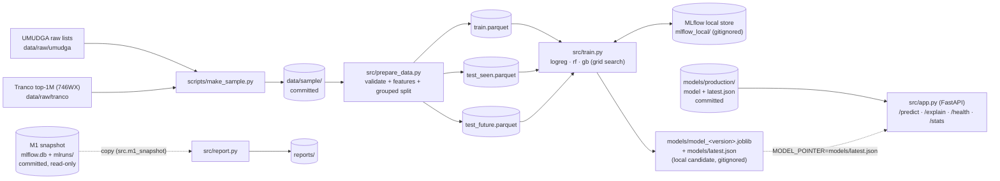

# DGAlert

**Flags malware-generated domain names (DGA) from the domain string alone, served as a FastAPI service.**

DGAlert classifies a domain such as `moiqidfvjjhjmndqp.in` as `benign` or `dga` (made by a malware
Domain Generation Algorithm) using 15 lexical features of its second-level label, and explains each
decision with SHAP. It is the Milestone 1 deliverable of an MLOps course project (BS CS, IBA,
Fall 2026). Milestone 2 adds automated retraining (KaizenML) as new malware families appear.

## Contents

1. [Architecture](#architecture)
2. [Quick start](#quick-start)
3. [Data](#data)
4. [Results](#results)
5. [Explainability and the drift story](#explainability-and-the-drift-story)
6. [API](#api)
7. [Docker](#docker)
8. [Deployment](#deployment)
9. [Limitations](#limitations)
10. [Tests](#tests)
11. [Citations](#citations)

## Architecture



All features are defined once in `src/features.py` and used by `prepare_data`, `train`, the API
and the explainer. Features use only the second-level label (`mail.google.co.uk` -> `google`,
via `tldextract` with its bundled public suffix list). The n-gram and dictionary features come from
a fixed English word list in `data/reference/`, never from the training data, to avoid leakage.

## Quick start

**Requires Python 3.13.**

`data/raw/` is not needed: `prepare_data` reads the committed sample in `data/sample/`.

Windows (PowerShell, from the repo root):

```powershell
py -3.13 -m venv venv
venv\Scripts\python -m pip install -r requirements.txt

venv\Scripts\python -m uvicorn src.app:app       # serves the committed model; no training needed
                                                 # API at http://127.0.0.1:8000, docs at /docs
venv\Scripts\python -m pytest -q

venv\Scripts\python -m src.prepare_data          # writes data/processed/
venv\Scripts\python -m src.prepare_retrain       # retraining data + reports/eval_frozen.json (after prepare_data)
venv\Scripts\python -m src.train --model all     # trains logreg, rf, gb; writes models/latest.json
venv\Scripts\mlflow ui --backend-store-uri sqlite:///mlflow_local/mlflow.db   # your runs, http://127.0.0.1:5000

venv\Scripts\python -m src.m1_snapshot             # copy of the M1 runs; prints its `mlflow ui` command
venv\Scripts\python -m src.report                  # rebuilds reports/ (needs data/processed/)
```

Training takes about 11 minutes. Most of it is the gradient boosting model: about 6 minutes of grid
search (27 grid points x 3 folds) and about 4.4 minutes refitting the best grid point on the full
train set.

Linux/macOS equivalents (see `Makefile`):

| Step | Command |
|---|---|
| venv + install | `make setup` |
| prepare data | `make data` |
| retraining data (after `make data`) | `make retrain-data` |
| train (all models) | `make train` |
| rebuild `reports/` | `make report` |
| browse the M1 runs (copy + `mlflow ui` command) | `make mlflow-m1` |
| tests | `make test` |
| ruff lint + format check | `make lint` |
| serve the API (with `--reload`) | `make serve` |

Training logs to a local, gitignored MLflow store in `mlflow_local/` and does not touch `reports/`.
`models/latest.json` is only replaced when the new best model has a strictly higher `f1_seen` than
the current one (`python -m src.train --force` overrides this).

### MLflow stores and reports

| Store | Where | Written by |
|---|---|---|
| Local store (new runs) | `mlflow_local/mlflow.db` + `mlflow_local/mlruns/`, gitignored | `src.train` |
| M1 snapshot | `mlflow.db` + `mlruns/`, committed | nothing: read-only |
| M1 working copy | `mlflow_m1/`, gitignored | `src.m1_snapshot`, `src.report` |

- **New runs** go to the local store. Set `DGALERT_MLFLOW_TRACKING_URI` (and, for a SQLite store,
  `DGALERT_MLFLOW_ARTIFACT_DIR`) to log elsewhere, e.g. a CI workspace. The names are prefixed so a
  global `MLFLOW_TRACKING_URI` set for another project cannot redirect DGAlert runs. Training
  refuses to write to the committed `mlflow.db`.
- **The M1 snapshot** (`mlflow.db`, `mlruns/`) holds the Milestone 1 runs and is never written
  again. Its SHA-256 is recorded in `src/config.py` (`M1_SNAPSHOT_DB_SHA256`) and the test suite
  fails if it changes. To browse it, make a working copy:

  ```powershell
  venv\Scripts\python -m src.m1_snapshot
  ```

  This checks the hash, copies the store to `mlflow_m1/` (replacing any earlier copy), rewrites the
  copy's artifact paths for this machine (MLflow stores them as absolute paths) and prints the
  `mlflow ui --backend-store-uri sqlite:///.../mlflow_m1/mlflow.db --port 5000` command to run.
- **`python -m src.report`** rebuilds `reports/` from a fresh working copy: `m1_results.json` and
  `per_family_recall.json` compare the three M1 parent runs, and `production_model.json` describes
  the model the API serves. It finds the MLflow run named by `mlflow_run_id` in
  `models/production/latest.json`, in the local store or the M1 snapshot, and records its params,
  metrics and per-family recall, plus the store's label (`local` or `m1_snapshot`). It
  needs `data/processed/split_report.json` (`python -m src.prepare_data`). The files contain no
  timestamps or paths, so rerunning it leaves `git status` clean.

### Production model and requirements

The API serves the **committed production model** in `models/production/` (the M1 `gb` model,
version `20261105_062411`, MLflow run `9c15d284722c46fc9355f98e134b44d1`). Its `latest.json`
records the file's SHA-256, the scikit-learn and Python versions, the feature names and the
families phased in by retraining (none yet). Training never writes there: `src.train` writes a
local, gitignored candidate to `models/` and `models/latest.json`. To serve that candidate instead:

```powershell
$env:MODEL_POINTER = "models/latest.json"; venv\Scripts\python -m uvicorn src.app:app
```

A relative `MODEL_POINTER` and the `path` inside a pointer are resolved against the repo root, so
the service works from any working directory. At startup the loader checks the model file's
SHA-256 against the pointer and refuses a mismatching file (`/health` and `/predict` return 503
and the server log gives the reason). A pointer without `sha256` still loads, with a warning, and a
warning is logged if the installed scikit-learn differs from the one the model was saved with.

Requirements are split: `requirements-api.txt` holds only what the API needs at runtime (no
mlflow, pytest or ruff; meant for a slim deployment image), and `requirements.txt` includes it
and adds the training and dev tools, so `pip install -r requirements.txt` still installs
everything.

## Data

### Sources

- **DGA domains: UMUDGA** (Zago, Gil Pérez and Martínez Pérez, 2020), Mendeley Data,
  DOI [10.17632/y8ph45msv8.1](https://doi.org/10.17632/y8ph45msv8.1), MIT licence.
  For each family only `<family>/list/10000.txt` is used; the family name is the folder name.
- **Benign domains: Tranco** top-1M list
  [`746WX`](https://tranco-list.eu/list/746WX/1000000). Tranco averages several popularity
  rankings over 30 days, so it is much harder to manipulate than a single ranking.

The raw files are downloaded manually into `data/raw/` (gitignored). `scripts/make_sample.py`
builds the committed sample in `data/sample/`; `data/sample/SAMPLE_INFO.md` records every
parameter, the Tranco file's SHA-256 and all drop counts.

### Sample

| | Rows |
|---|---|
| Domains per UMUDGA family | up to 3000 (seed 42) |
| DGA rows, training families | 96000 |
| DGA rows, held-out families | 42000 |
| DGA rows, total | 138000 |
| Benign rows (Tranco) | 96000 |

Benign rows are sampled **evenly across the ten 100k-rank bands** of Tranco (9600 per band), not
taken from the top N. The top of the list is dominated by short, famous brand names, which are
easy to tell apart from random strings. A DNS resolver sees the whole long tail, so the benign set
should too; otherwise the model learns "short and famous = benign" and the test scores are
optimistic.

The benign count equals the number of training-family DGA rows (96000), so train is about 50/50
benign vs DGA. The per-family cap of 3000 keeps any single family from dominating.

Cleaning dropped 6 Tranco `_wildcard_` rows, 1447 punycode (`xn--`) domains, 11 bare public
suffixes, and 10 domains that appeared both in Tranco and in a DGA list (dropped from both sides).

### Excluded families (never used)

`corebot`, `symmi`, `kraken_v1`, `kraken_v2`, `legit`.

- `corebot`, `symmi`, `kraken_v1`, `kraken_v2` put the generated string in a dynamic-DNS
  subdomain (e.g. `x.ddns.net`), so their second-level label is just the provider's name. A
  second-level-label classifier cannot see them.
- `legit` is UMUDGA's own benign list. It overlaps Tranco heavily, and Tranco is our benign source.

### Held-out families (simulated future malware)

`matsnu`, `nymaim`, `banjori`, `sisron`, `simda`, `dyre`, `padcrypt`, `shiotob`, `necurs`,
`qakbot`, `tinba`, `murofet_v1`, `murofet_v2`, `murofet_v3`.

These 14 of the 46 usable families (about 30%, chosen by the team) never appear in training.
Their rows go only to `test_future`, which simulates malware that appears after the model was
trained. `f1_future` and per-family recall on `test_future` are the drift baseline that
Milestone 2's automated retraining has to improve on. The set mixes word-based (matsnu, nymaim),
pronounceable or seed-based (banjori, simda, sisron) and random-character families.

### Split

`src/prepare_data.py` validates the sample, computes features, and splits it:

- Training families + benign are split 80/20 with `GroupShuffleSplit` **grouped by second-level
  label** (seed 42), so the same label (e.g. `google` from `google.com` and `google.de`) can
  never be in both train and test.
- `test_seen` is that 20%.
- `test_future` is the held-out-family DGA rows plus the benign rows of `test_seen`. Held-out
  rows whose label also occurs in train are dropped (3 rows).

| Split | Rows | Benign | DGA | Benign fraction |
|---|---|---|---|---|
| train | 153627 | 76856 | 76771 | 0.5003 |
| test_seen | 38373 | 19144 | 19229 | 0.4989 |
| test_future | 61141 | 19144 | 41997 | 0.3131 |

Second-level labels shared between train and test_seen: **0**. Between train and test_future: **0**
(`data/processed/split_report.json`).

### Retraining data (Milestone 2)

`src/prepare_retrain.py` (run after `prepare_data`) derives the data for the retraining loop from
the three splits above, which it does not change:

| Part | Rows | What it is |
|---|---|---|
| `train_fit` | 138248 | train minus validation: what retraining fits on (plus phased-in rows) |
| `validation` | 15379 | about 10% of train, for choosing hyperparameters |
| `phase_in_pool` | 33570 | about 80% of each held-out family: added to training one batch per round |
| `eval_frozen` | 46800 | `test_seen` (38373) + about 20% of each held-out family (8427): the fixed set every candidate is scored on |

- **One rule for both selections.** A second-level label goes to the frozen eval slice (or to
  validation) when `sha256("<salt>:<label>")`, read as a fraction, is below 0.2 (or 0.1).
  - The salts are `frozen-eval` and `validation`.
  - Membership depends only on the label, so it does not change when other rows or families
    change, and every domain with the same label lands on the same side.
  - Actual shares: 19.0% to 21.0% per held-out family, and 9.1% to 11.4% per family of train.
- **No leakage.** No second-level label is shared between any two parts; the script checks this
  and stops if one is.
- **Frozen hash.** The frozen eval set's hash (SHA-256 over its sorted `domain,label` lines) and its
  rows per family are committed in `reports/eval_frozen.json` (`sha256` `78f48f6b…`). The promotion
  gate (slice S10) is to refuse to compare models on a set with another hash.
- **Phase-in batches** (`config.PHASE_IN_BATCHES`), ordered by M1 gb recall on test_future, worst
  first:

| Batch | Families | M1 gb recall | Pool rows | Frozen eval rows |
|---|---|---|---|---|
| 1 | matsnu | 0.049 | 2409 | 589 |
| 2 | nymaim, simda | 0.211, 0.432 | 2391, 2430 | 609, 569 |
| 3 | dyre, shiotob | 0.646, 0.740 | 2381, 2370 | 619, 630 |
| never (control) | banjori, sisron, padcrypt, necurs, qakbot, tinba, murofet_v1, murofet_v2, murofet_v3 | 0.98 to 1.00 | 21589 | 5411 |

The control families are never phased in. Their recall cannot rise by the gate's margin, and
keeping them unseen still measures how the model does on families it was never trained on.

## Results

Three MLflow parent runs in experiment `dgalert-m1` (seed 42, threshold 0.5 on P(dga), positive
class = dga). Numbers come from `reports/m1_results.json`, which `src/report.py` builds from MLflow.

| Model | Features | f1_seen | precision_seen | recall_seen | f1_future | recall_future | train_time_s |
|---|---|---|---|---|---|---|---|
| logreg | 8 basic (no dictionary / n-gram) | 0.7635 | 0.7721 | 0.7552 | 0.8414 | 0.8003 | 0.6825 |
| rf | all 15 | 0.884 | 0.8828 | 0.8852 | 0.8549 | 0.7867 | 10.487 |
| **gb** | all 15 | **0.8891** | **0.8929** | **0.8853** | **0.8584** | **0.7885** | 261.2648 |

- **logreg**: `StandardScaler` + `LogisticRegression` (C=1.0, `class_weight="balanced"`).
- **rf**: `RandomForestClassifier`, 100 trees, `class_weight="balanced"`.
- **gb**: `GradientBoostingClassifier`, tuned by grid search (27 grid points, 3-fold `GroupKFold` by
  second-level label, on a stratified 40000-row subsample of train). Every grid point is a nested
  MLflow child run. Best grid point: `n_estimators=200`, `max_depth=7`, `learning_rate=0.05`, with
  CV F1 0.8841 ± 0.0026. It was then refit on the full train set.

### Why f1_seen and f1_future are not comparable

The two test sets have different class balance:

| Test set | Rows | DGA rows | DGA share |
|---|---|---|---|
| test_seen | 38373 | 19229 | 0.5011 |
| test_future | 61141 | 41997 | 0.6869 |

F1 depends on precision, and precision rises when positives are more common. With 68.69% DGA rows
in `test_future`, every model's precision there is inflated. That is why `f1_future` is *higher*
than `f1_seen` for logreg even though it misses whole families. **Compare recall instead:** gb
catches 0.8853 of DGA domains from families it has seen but only 0.7885 from families it has not.

### Why gb

`gb` is the deployed model (`models/production/`), chosen because:

1. **It is best on the metric we declared in advance, `f1_seen`** (0.8891 vs 0.884 for rf).
2. **Its artifact is much smaller** than the 100-tree, full-depth random forest. That matters for
   loading time now and for the Docker image in Milestone 2.
3. **SHAP is much faster on it.** `TreeExplainer` on shallow boosted trees (`max_depth=7`) is far
   cheaper than on fully grown random-forest trees, and `/explain` runs SHAP on every request.

To be honest about the margin: gb's lead over rf is small (0.0051 F1 on `test_seen`, 0.0035 on
`test_future`), and rf is better on some families (e.g. `suppobox_2`, `vawtrak_v3`, `rovnix` in
`test_seen`). On accuracy alone the two are close; points 2 and 3 decide it.

Two caveats about the tuning:

- **The best `max_depth` (7) is the largest value in the grid** (3, 5, 7), and the best
  `learning_rate` (0.05) is the smallest (0.05, 0.1, 0.2). So the search did not show that deeper
  trees or a smaller learning rate would be worse; it only found the best point inside this grid.
- **gb's `train_time_s` (261.2648) is the final refit only.** The grid search before it is not
  included. By the MLflow run timestamps it ran for 357 s of the 622 s gb run, which makes it the
  biggest single part of the ~11-minute training.

### Per-family recall (gb)

Full tables for all three models: `reports/per_family_recall.json`. For DGA families the value is
recall; for `benign` it is the share predicted benign.

**test_seen** (families seen in training):

- Perfect (1.0): `fobber_v1`, `qadars`, `ramdo`, `ranbyus_v1`, `ranbyus_v2`, `zeus-newgoz`.
- Weakest: `suppobox_2` 0.2228, `vawtrak_v3` 0.6054, `pizd` 0.6931, `suppobox_1` 0.697.
- Benign: 0.8934.
- The dictionary and n-gram features help a lot: logreg, which does not get them, scores 0.0 on
  `pushdo`, `vawtrak_v2` and `vawtrak_v3` (gb: 0.913, 0.8125, 0.6054).

**test_future** (held-out families):

- Caught almost fully: `banjori` 1.0, `murofet_v1` 1.0, `murofet_v3` 1.0, `murofet_v2` 0.9987,
  `sisron` 0.9987, `padcrypt` 0.998, `tinba` 0.9927, `qakbot` 0.9917, `necurs` 0.981.
- Missed: `matsnu` 0.0494, `nymaim` 0.2107, `simda` 0.4315, `dyre` 0.646, `shiotob` 0.7403.

## Explainability and the drift story

`POST /explain` returns the prediction plus the features that pushed it toward `dga` (positive
contribution) or `benign` (negative). For gb the contributions are SHAP values in log-odds, and
`base_value` plus all 15 contributions equals the model's log-odds (checked in the tests).

### matsnu: "hyphen + English words = benign"

The real response for `wedding-muscle.com`, a matsnu domain from the held-out set:

```json
{
  "domain": "wedding-muscle.com",
  "label": "benign",
  "probability": 0.0036,
  "model_version": "20261105_062411",
  "in_scope": true,
  "warning": null,
  "output_units": "log_odds",
  "base_value": -0.03691765562588492,
  "top_contributing_features": [
    {"feature": "hyphen_count", "value": 1.0, "contribution": -3.42574984061764},
    {"feature": "bigram_unseen_ratio", "value": 0.15384615384615385, "contribution": -1.021768467627285},
    {"feature": "trigram_mean_logfreq", "value": -3.9781896608308833, "contribution": -0.5972774506335715},
    {"feature": "bigram_mean_logfreq", "value": -2.837270528388683, "contribution": -0.39355988586259727},
    {"feature": "dict_coverage", "value": 1.0, "contribution": -0.30221298405663727}
  ]
}
```

`hyphen_count` dominates: one hyphen pushes the log-odds down by 3.43, about three times as much as
the next feature. The rest is the label looking like English: common n-grams and full dictionary
coverage.

The reason is in the training data. **None of the training DGA labels contains a hyphen**, while
hyphenated names are common among real benign sites. So the model learned the shortcut
"hyphen + English words = benign". matsnu builds its domains exactly that way, joining dictionary
words with hyphens, so all three models catch only about 5% of it (`matsnu` recall: gb 0.0494,
rf 0.0457, logreg 0.0587).

This is the drift Milestone 2 has to handle. Once labelled matsnu domains reach the training set,
retraining gives the model hyphenated DGA examples and the shortcut stops working. Per-family recall
on `test_future` is the baseline that retraining should improve.

### dyre: a pattern trees cannot extrapolate to

dyre labels are one letter followed by 33 hex characters (e.g.
`a022b679b3dcd50dda1b4c6633662a3512`): 34 characters long, which is longer than any DGA label in
training. Both tree models miss about a third of them (`dyre` recall: gb 0.646, rf 0.641), while
logreg catches all of them (1.0).

A tree can only split on values it saw during training. For any value beyond the training range it
returns the prediction of the edge region, so it cannot extrapolate. SHAP on gb's misses shows the
biggest pushes toward benign come from `digit_ratio` and `unique_char_ratio`. A 34-character label
drawn from only 16 hex symbols has a low unique-character ratio, which in the training data was
far more common among long benign labels than among DGA labels. `length` itself contributes only a little. A
linear model has no such edge: its score keeps moving in the same direction outside the training
range, and logreg (trained only on the 8 basic character features) flags every dyre label.

## API

| Method | Path | Purpose |
|---|---|---|
| `POST` | `/predict` | Classify one domain: `label` (`benign` or `dga`) and P(dga) |
| `POST` | `/explain` | The same prediction plus the top 5 SHAP feature contributions |
| `GET` | `/health` | Model and explainer status: 200 `healthy` or `degraded`, 503 `unhealthy` (used by health checks) |
| `GET` | `/stats` | Request counts, latency and prediction statistics since the service started |
| `GET` | `/docs` | Interactive OpenAPI docs with request and response examples |
| `GET` | `/` | Redirects (307) to `/docs` |

Start the server, then open **http://127.0.0.1:8000/docs** for the interactive OpenAPI docs (with
request and response examples):

```powershell
venv\Scripts\python -m uvicorn src.app:app
```

The model and the explainer are loaded once at startup from `models/production/latest.json` (the
`MODEL_POINTER` environment variable overrides that path; see
[Production model and requirements](#production-model-and-requirements)). If loading fails,
including a failed SHA-256 check, the service still starts: `/health` reports it, and `/predict`
and `/explain` return 503.

The raw input may be at most 1,024 characters, checked before anything else (a domain is at most
253; the rest leaves room for a pasted URL). It is then normalized (trimmed, lowercased; scheme,
path, port and trailing dot removed, so `HTTP://Example.COM/path` becomes `example.com`) and must
be a valid DNS name: ASCII only, at
least one dot, labels of 1-63 letters/digits/hyphens with no leading or trailing hyphen, at most
253 characters, and not a bare public suffix like `co.uk`. It must also end in a known public
suffix: IP addresses (`8.8.8.8`) and internal names (`host.local`, `abc.internal`) are rejected,
because the model never saw them in training and would score the wrong label (for
`pidfksipycmyg.local` it would look at `local`). Anything else gets a 422 with a message.

### Scope warnings

Some valid domains are outside what the model can judge. They still get a prediction, but the
response says `"in_scope": false` and gives a `warning`; for every other domain `in_scope` is
`true` and `warning` is `null`. Both fields are in `/predict` and `/explain`, and `/stats` counts
out-of-scope predictions in `predictions.out_of_scope`.

- **Private suffixes** (C1), e.g. `x.blogspot.com`, `x.duckdns.org`, `x.github.io`: the features
  use the second-level label under the *public* suffix list, which here is the provider's name
  (`blogspot`), so the part a DGA would generate (`x`) is never seen. Detected with `tldextract`
  including the list's private section. The provider's own domain (`blogspot.com`) is in scope.
- **Punycode** (C2): any label starting with `xn--` (`xn--bcher-kva.de`, `example.xn--p1ai`).
  These encode internationalized names, which the ASCII training data does not cover.

```json
{"domain": "abcxyzqwrtplk.blogspot.com", "label": "benign", "probability": 0.0451, "model_version": "20261105_062411", "in_scope": false, "warning": "'abcxyzqwrtplk.blogspot.com' is under the private suffix 'blogspot.com' (a hosting or dynamic-DNS provider); the model only sees the label 'blogspot', so the prediction says nothing about 'abcxyzqwrtplk'."}
```

### `POST /predict`

```bash
curl -X POST http://127.0.0.1:8000/predict -H "Content-Type: application/json" -d '{"domain": "moiqidfvjjhjmndqp.in"}'
```

```json
{"domain": "moiqidfvjjhjmndqp.in", "label": "dga", "probability": 0.996, "model_version": "20261105_062411", "in_scope": true, "warning": null}
```

```json
{"domain": "teco.com.tw", "label": "benign", "probability": 0.0021, "model_version": "20261105_062411", "in_scope": true, "warning": null}
```

Both example domains are from `test_seen`, so the model never trained on them:
`moiqidfvjjhjmndqp.in` is a `ranbyus_v2` DGA domain and `teco.com.tw` is a Tranco domain.
`probability` is P(dga), rounded to 4 decimals; `label` is `dga` when it is at least 0.5.
`in_scope` and `warning` are explained under [Scope warnings](#scope-warnings).

Invalid input, HTTP 422. For `-bad.com`:

```json
{"detail": [{"type": "value_error", "loc": ["body", "domain"], "msg": "Value error, label '-bad' must not start or end with a hyphen", "input": "-bad.com", "ctx": {"error": {}}}]}
```

For `8.8.8.8`:

```json
{"detail": [{"type": "value_error", "loc": ["body", "domain"], "msg": "Value error, '8.8.8.8' has no known public suffix; IP addresses and internal names are not supported", "input": "8.8.8.8", "ctx": {"error": {}}}]}
```

### `POST /explain`

Same request and validation as `/predict`. The response adds `base_value`, the 5 features with
the largest absolute contribution, and `output_units`: the units of `base_value` and the
contributions, `log_odds` for gb and logreg or `probability` (P(dga)) for rf (see the
`wedding-muscle.com` example above):

```bash
curl -X POST http://127.0.0.1:8000/explain -H "Content-Type: application/json" -d '{"domain": "wedding-muscle.com"}'
```

### `GET /health`

```bash
curl http://127.0.0.1:8000/health
```

```json
{"status": "healthy", "model_loaded": true, "explainer_loaded": true, "git_sha": "67fc13b", "model_version": "20261105_062411"}
```

`git_sha` is the commit the running image was built from (Docker build arg `GIT_SHA`, see
[Docker](#docker)), so a deployment can be identified; it is `"unknown"` when not set, e.g. when
running from a venv.

| `status` | HTTP | When |
|---|---|---|
| `healthy` | 200 | model and explainer loaded |
| `degraded` | 200 | model loaded but the explainer failed: `/predict` works, `/explain` returns 503 |
| `unhealthy` | 503 | no model (`{"status": "unhealthy", "model_loaded": false, "explainer_loaded": false, "git_sha": "..."}`) |

`degraded` stays 200 so that Docker and Render health checks do not restart a service that still
answers `/predict`; the body and the server log say what failed.

### `GET /stats`

Monitoring counters since the service started. It always returns 200, also without a model
(`model_version` is then `null`).

```bash
curl http://127.0.0.1:8000/stats
```

```json
{
  "model_version": "20261105_062411",
  "started_at": "2026-11-25T09:00:00.000+00:00",
  "uptime_seconds": 123.456,
  "requests": {
    "total": 6,
    "by_status_class": {"2xx": 5, "4xx": 1},
    "avg_latency_ms": 7.512,
    "by_endpoint": {
      "GET /health": {"count": 2, "by_status_class": {"2xx": 2}, "avg_latency_ms": 0.811},
      "POST /predict": {"count": 4, "by_status_class": {"2xx": 3, "4xx": 1}, "avg_latency_ms": 10.863}
    }
  },
  "predictions": {"count": 3, "by_label": {"benign": 2, "dga": 1}, "mean_probability_dga": 0.3349, "out_of_scope": 1}
}
```

- `requests` counts every request, per status class (`2xx`, `4xx`, ...) and per endpoint, keyed by
  method and route. Requests that match no route (e.g. scans for `/wp-admin`) are grouped under
  `unmatched`. Latency is measured in the service, from request in to response out.
- `predictions` covers successful `POST /predict` calls only (`/explain` is not counted):
  the count per label, the mean P(dga), and how many were out of scope (`in_scope: false`).
- **Counters are in memory and reset whenever the service restarts.** On Render's free tier an
  idle service is put to sleep and restarted on the next request, so `started_at` shows how long
  the counters cover. The `/stats` call itself is counted after its response is built.
- **Health checks inflate `requests.total`.** Docker's `HEALTHCHECK` and Render's health checks call
  `/health` regularly, so the totals rise with no user traffic. For demos, read `POST /predict`
  under `by_endpoint` and the `predictions` block.

Every request also writes one JSON line to stdout (logger `dgalert.access`), next to uvicorn's own
access line. Request bodies are never logged, so the domain does not appear; `/predict` adds only
the label and probability:

```json
{"timestamp": "2026-11-25T09:00:01.234+00:00", "method": "POST", "path": "/predict", "status": 200, "latency_ms": 9.81, "label": "dga", "probability": 0.996}
```

## Docker

Build the API image and run it (PowerShell or bash, from the repo root):

```bash
docker build --build-arg GIT_SHA=$(git rev-parse --short HEAD) -t dgalert:local .
docker run --rm -p 8000:8000 --name dgalert dgalert:local
```

On Linux/macOS, `make docker-build` and `make docker-run` do the same. The API is then at
http://127.0.0.1:8000 (docs at `/docs`), and `docker ps` shows the container as `(healthy)` about
10 seconds after it starts. Stop it with Ctrl+C or `docker stop dgalert`.

- **Image**: multi-stage build on `python:3.13.18-slim-trixie` (Python 3.13.18, Debian 13), pinned
  to the exact patch release. The builder installs only `requirements-api.txt` into a venv (no
  mlflow, pytest or ruff); the runtime stage copies that venv, `src/`, `data/reference/` (the word
  list the features load) and `models/production/`. About 705 MB unpacked (161 MB compressed).
- **Runs as a non-root user** (`dgalert`, uid 10001) that cannot modify the code, the model or the
  installed packages. `NUMBA_CACHE_DIR=/tmp/numba_cache` gives shap's numba a writable cache folder.
- **Port**: uvicorn listens on `0.0.0.0:${PORT:-8000}`, so a platform that sets `PORT` (Render)
  works unchanged: `docker run --rm -e PORT=9000 -p 9000:9000 dgalert:local`.
- **Health check**: Docker calls `/health` with Python's `urllib` (slim images have no curl) every
  2 seconds while starting and every 10 seconds after. `healthy` and `degraded` (200) pass;
  `unhealthy` (503) fails. These calls show up in `/stats` and in the log.
- **Logs**: one JSON line per request on stdout (`docker logs dgalert`); uvicorn's own access
  line is switched off (`--no-access-log`).
- **`GIT_SHA`**: the build arg is stored in the image and returned by `/health`, which identifies
  the deployed commit. Without it the value is `unknown`.

## Deployment

The API runs on Render (free instance) at **https://dgalert.onrender.com** (docs at
https://dgalert.onrender.com/docs). The Render web service runs the prebuilt image
`ghcr.io/piranchall/dgalert` from GHCR (no build on Render) with health-check path `/health`.

Every merge to `main` deploys itself, with no manual step:

1. CI's `lint` and `test` pass, and `build` builds the image, smoke-tests it and pushes it to GHCR
   as `sha-<short sha>` and `main` (see [CI](#ci)).
2. The `deploy` job runs the reusable workflow `.github/workflows/deploy.yml` with that `sha-`
   tag. It checks that the image exists, then calls the service's deploy hook (GitHub secret
   `RENDER_DEPLOY_HOOK`) with `imgURL=ghcr.io/piranchall/dgalert:sha-<short sha>`, so Render runs
   exactly the image that was tested, not whatever `:main` points to at that moment.
3. It then polls https://dgalert.onrender.com/health every 10 seconds until `git_sha` is the
   merged commit, and fails after about 10 minutes if it never is.

Rollbacks and roll-forwards use the same workflow by hand, with no Render login
(`gh workflow run deploy.yml -f tag=sha-<short sha>`): see [RUNBOOK.md](RUNBOOK.md), which also
covers model rollbacks, running a production image locally and what to check when the health
check fails.

Version tags (`v*`) publish an image but do not deploy. **Cold starts:** a free instance stops
after about 15 minutes without traffic, and the next request waits (up to about a minute) while
it starts again. `/stats` counts from that start, so it resets after every spin-down and every
deploy.

Calling the live service (bash, macOS/Linux, Git Bash):

```bash
curl https://dgalert.onrender.com/health
curl -X POST https://dgalert.onrender.com/predict -H "Content-Type: application/json" -d '{"domain": "moiqidfvjjhjmndqp.in"}'
curl -X POST https://dgalert.onrender.com/explain -H "Content-Type: application/json" -d '{"domain": "wedding-muscle.com"}'
curl https://dgalert.onrender.com/stats
```

In PowerShell, write `curl.exe` (plain `curl` is an alias for `Invoke-WebRequest`), and in Windows
PowerShell 5.1 escape the quotes inside the JSON body:

```powershell
curl.exe https://dgalert.onrender.com/health
curl.exe -X POST https://dgalert.onrender.com/predict -H "Content-Type: application/json" -d '{\"domain\": \"moiqidfvjjhjmndqp.in\"}'
curl.exe -X POST https://dgalert.onrender.com/explain -H "Content-Type: application/json" -d '{\"domain\": \"wedding-muscle.com\"}'
curl.exe https://dgalert.onrender.com/stats
```

(PowerShell 7.3 and later pass quotes through unchanged: there, use the bash form of the body,
`-d '{"domain": "moiqidfvjjhjmndqp.in"}'`.)

## Limitations

- **Purely lexical features.** The model sees only the characters of the second-level label: no
  DNS responses, WHOIS age or traffic. Word-based DGAs can look exactly like a real two-word business
  name. `suppobox` is a training family and still partly missed in `test_seen` (gb recall:
  `suppobox_1` 0.697, `suppobox_2` 0.2228, `suppobox_3` 0.9777). Held-out word-based families do
  worse (`matsnu` 0.0494, `nymaim` 0.2107).
- **Dynamic-DNS families are out of scope.** `corebot`, `symmi`, `kraken_v1` and `kraken_v2` are
  excluded because their generated string sits in a subdomain the features never look at.
- **Punycode was excluded from training.** The 1447 `xn--` domains in Tranco were dropped, so the
  model has never seen internationalized domains. The API accepts `xn--` names, but their
  predictions are unreliable.
- **The benign set is skewed toward lower ranks.** Sampling evenly across rank bands means 9 of
  the 10 bands, and so 90% of benign rows, come from below the top 100,000. Less popular domains
  look more random, so more of them are flagged as DGA. This lowers precision, but it is closer to
  what a resolver really sees than a top-N list would be.
- **One hyphen hides a DGA domain.** `scripts/hyphen_evasion.py` takes 2000 `test_seen` DGA domains
  (seed 42) that gb labels dga and inserts one hyphen in the middle of each second-level label
  (`moiqidfvjjhjmndqp.in` -> `moiqidfv-jjhjmndqp.in`). The share still labelled dga is **0.0000**:
  every one of them flips to benign. Our demo domain drops from P(dga) 0.996 to 0.0067, and
  `/explain` puts `hyphen_count` at -7.50 log-odds. The cause is the training data: **0 of the
  76771 training DGA rows** have a hyphen in their second-level label, while hyphens do occur in
  benign names, so the model learned "hyphen = benign". This is also why matsnu is missed (see
  [the drift story](#matsnu-hyphen--english-words--benign)). The planned fix is Milestone 2's
  retraining on hyphenated families such as matsnu. Run it with `python -m scripts.hyphen_evasion`
  (needs `data/processed/` and a trained model).
- **False alarms dominate when DGA traffic is rare.** gb's false-positive rate on `test_seen` is
  **0.1066**, derived as 1 minus gb's `benign` recall on `test_seen` (0.8934) in
  `reports/per_family_recall.json`. `test_seen` is about half DGA, but real DNS traffic is mostly
  benign. Take 10,000 domains of which 1% (100) are DGA. With `recall_seen` 0.8853, gb finds about
  89 of the 100, but it also flags about 1,055 of the 9,900 benign domains (9,900 x 0.1066). Only
  about 7.7% of its alerts would be real (precision 88.53 / (88.53 + 1055.34) = 0.0774).
  Threshold-independent metrics (ROC-AUC) and a separate validation split for model selection are
  planned for Milestone 2.

MLflow saves artifact locations as absolute paths, so the committed M1 store is only read through
a working copy whose paths are rewritten for this machine (`src/m1_snapshot.py`,
`src/mlflow_store.py`); see [MLflow stores and reports](#mlflow-stores-and-reports).

## Tests

```powershell
venv\Scripts\python -m pytest -q
venv\Scripts\ruff check src tests scripts
venv\Scripts\ruff format --check src tests scripts
```

### CI

GitHub Actions (`.github/workflows/ci.yml`, Ubuntu, Python 3.13) runs on every pull request, on
pushes to `main` and on `v*` tags. `lint`, `test` and `build` are the required status checks;
`deploy` runs only on pushes to `main`:

| Job | What it does |
|---|---|
| `lint` | `ruff check` and `ruff format --check` (installs only the ruff version pinned in `requirements.txt`) |
| `test` | `pytest -q` with `requirements.txt`, including the sanity tests on the production model |
| `build` | after `lint` and `test` pass: builds the Docker image with `GIT_SHA`, waits until Docker reports it healthy, checks that `/health` shows that commit and that `/predict` labels `moiqidfvjjhjmndqp.in` as `dga`, then stops it |
| `deploy` | pushes to `main` only, after `build`: runs `deploy.yml` with the image's `sha-` tag, which deploys it to Render and waits until the live `/health` reports the commit (see [Deployment](#deployment)) |

On pushes to `main` and `v*` tags only, `build` then pushes **the image it just tested** to the
GitHub Container Registry as `ghcr.io/piranchall/dgalert:sha-<short sha>`, plus `:main` or the
version tag (e.g. `:v2.0-milestone2`). Pull requests never push. To run a published image:

```bash
docker pull ghcr.io/piranchall/dgalert:main
docker run --rm -p 8000:8000 ghcr.io/piranchall/dgalert:main
```

| File | Covers |
|---|---|
| `tests/test_config.py` | paths inside the repo, local MLflow store and its env-var overrides, working folders gitignored, seed, family lists disjoint |
| `tests/test_features.py` | normalization, second-level label extraction, every feature, dictionary split |
| `tests/test_prepare_data.py` | validation drops, grouped split with no shared labels, held-out families only in test_future, identical output on a rerun |
| `tests/test_prepare_retrain.py` | hash rule and content-hash format, parts cover the inputs, no label shared between any two parts, about 10% / 20% per family, output independent of row order, membership stable when rows or families are added, one label stays on one side, phase-in batches; on the committed sample: M1 split counts unchanged, frozen eval report equal to the committed one, same hash on a second run |
| `tests/test_train.py` | training on a tiny fixture, MLflow runs, `latest.json` promotion (with `sha256`) and `--force`, report generation, training refuses the committed store and never writes `reports/`, `production_model.json` lookup across stores (deterministic, no paths or times) |
| `tests/test_m1_snapshot.py` | the committed `mlflow.db` hash and `mlruns/` unchanged after the viewer command, the copy relocated and refreshed, a changed snapshot refused, `reports/` rebuilt from the snapshot equal to the committed files (parsed JSON) |
| `tests/test_model_loader.py` | loading via `latest.json`, the `MODEL_POINTER` override, missing or malformed pointers, SHA-256 check (tampered file refused, missing hash warns), scikit-learn version warning, the committed production model (fields, hash, loading from another working directory) |
| `tests/test_app.py` | `/health` and `/predict`: success, 503 without a model or with a tampered model, every 422 validation rule |
| `tests/test_monitoring.py` | `/stats` counts per endpoint and status class, latency, label counts matching `/predict`, `unmatched` paths, reset on restart, working without a model; thread-safe counters; one JSON log line per request with no request body |
| `tests/test_hardening.py` | scope warnings for private suffixes and punycode (C1, C2) and their `/stats` count, `/health` `degraded` when the explainer fails (C3), the 1,024-character input limit checked before normalization (C4), `output_units` per model type (C5), `GET /` redirect (C6) |
| `tests/test_ci.py` | the CI workflow: jobs `lint`, `test`, `build` (build after the other two), triggers, pinned ruff, `packages: write` only for `build`, publishing only on pushes to `main` and `v*` tags, lowercase image name, smoke test with a timeout, `deploy` only on pushes to `main`, calling `deploy.yml` with the tested `sha-` tag |
| `tests/test_deploy_workflow.py` | `deploy.yml`: manual and CI triggers with a required tag, tag format (accepted and rejected examples), the tag reaching shell only through `env`, image-exists check before the hook, hook from the secret (never echoed) with `imgURL`, wait for the tag's commit with a timeout, one deploy at a time; README Deployment section; `RUNBOOK.md` commands match the workflow, its required sections, placeholders instead of example tags in rollback and roll-forward, the wait before picking the newest run, and the rehearsal record |
| `tests/test_docker.py` | `GIT_SHA` in `/health` (set, unset, and in the 503 body); static checks of the `Dockerfile` (pinned base image in both stages, only `requirements-api.txt`, non-root user, health check, port, command) and `.dockerignore` |
| `tests/test_explain.py` | `/explain` shape and agreement with `/predict`; SHAP additivity for gb, rf and the logreg fallback |
| `tests/test_hyphen_evasion.py` | hyphen insertion in `scripts/hyphen_evasion.py` keeps the suffix and splits the label in the middle |

The tests run from a clean clone with no `data/raw/`, `data/processed/` or trained candidate in
`models/`: they train tiny models on `data/sample/` or on synthetic data in a temporary folder.
They read the committed M1 snapshot only through copies in a temporary folder, and the run fails
if the committed `mlflow.db` hash changes.

Tests marked `@pytest.mark.sanity` check the committed production model in `models/production/`
(e.g. `teco.com.tw` is benign, `moiqidfvjjhjmndqp.in` is dga). They always run, in CI too. Run them
alone with `pytest -m sanity`.

## Citations

- **UMUDGA**: M. Zago, M. Gil Pérez, G. Martínez Pérez. "UMUDGA: A dataset for profiling
  algorithmically generated domain names in botnet detection." *Data in Brief* 30 (2020), 105400.
  Dataset: Mendeley Data, DOI [10.17632/y8ph45msv8.1](https://doi.org/10.17632/y8ph45msv8.1) (MIT licence).
- **Tranco**: V. Le Pochat, T. Van Goethem, S. Tajalizadehkhoob, M. Korczyński, W. Joosen.
  "Tranco: A Research-Oriented Top Sites Ranking Hardened Against Manipulation." *NDSS* 2019.
  List `746WX`: https://tranco-list.eu/list/746WX/1000000
- **SCOWL** (Spell Checker Oriented Word Lists), K. Atkinson, version 2020.12.07, size 50,
  American English: http://wordlist.aspell.net/. Licence in `data/reference/SCOWL-LICENSE.txt`.
- **tldextract**, J. Kurkowski: https://github.com/john-kurkowski/tldextract
- **SHAP**: S. M. Lundberg, S.-I. Lee. "A Unified Approach to Interpreting Model Predictions."
  *NeurIPS* 2017. S. M. Lundberg et al. "From local explanations to global understanding with
  explainable AI for trees." *Nature Machine Intelligence* 2 (2020).
- **scikit-learn**: F. Pedregosa et al. "Scikit-learn: Machine Learning in Python." *JMLR* 12
  (2011), 2825-2830.
- **MLflow**: M. Zaharia et al. "Accelerating the Machine Learning Lifecycle with MLflow."
  *IEEE Data Engineering Bulletin* 41(4), 2018.
- **FastAPI**, S. Ramírez: https://fastapi.tiangolo.com

## Licence

MIT, see [LICENSE](LICENSE). Team: Piranchal (29050) and Muhammad Hussain (28985).
